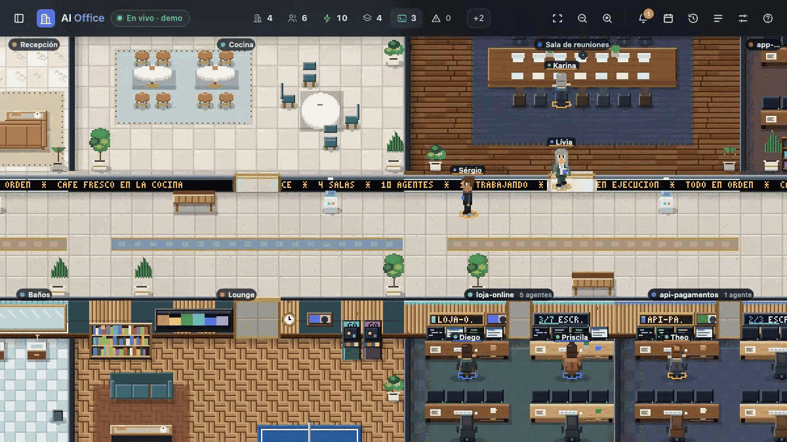
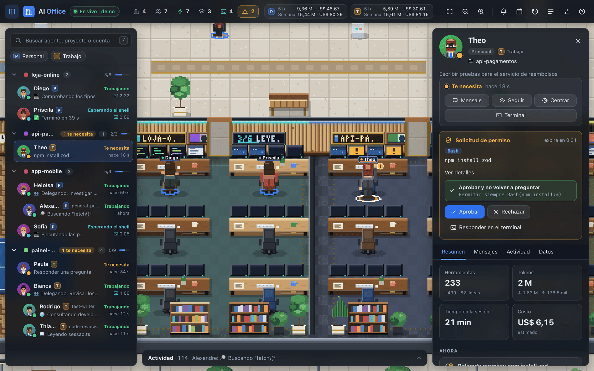
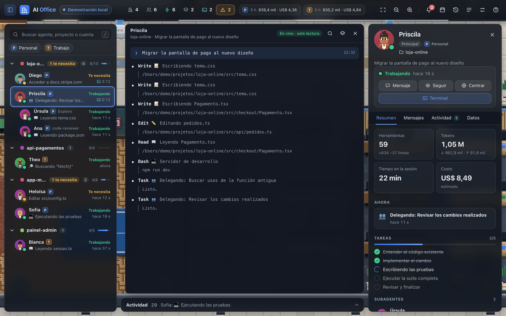
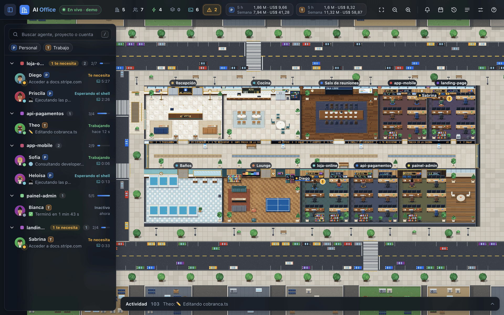
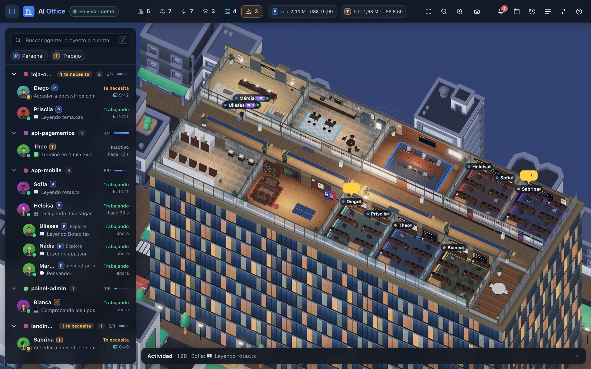

[English](README.md) · [Português (Brasil)](README.pt-BR.md) · **Español**

<a id="top"></a>

<p align="center">
  <picture>
    <source media="(prefers-reduced-motion: reduce)" srcset="docs/assets/readme/hero-still.svg" />
    
  </picture>
</p>

# AI Office

**Tus agentes de Claude Code, trabajando en una oficina en vivo.**

AI Office convierte las sesiones de Claude Code que corren en tu computadora en una oficina corporativa que puedes ver en tiempo real. Cada proyecto se vuelve una sala, cada sesión es una persona en su escritorio, y los subagentes son colegas que entran a la sala de reuniones, trabajan y se van.

Ves quién está trabajando, quién te necesita y quién espera un comando en el shell. Respondes solicitudes de permiso, envías instrucciones y repasas tu día sin cambiar de terminal. **Todo corre en `127.0.0.1`; nada sale de tu computadora.**

<p align="center">
  <a href="#install"><strong>INSTALA CON UN PROMPT →</strong></a>
  &nbsp; · &nbsp;
  <a href="#try-the-demo">PRUEBA LA DEMO</a>
  &nbsp; · &nbsp;
  <a href="#views">MÍRALO EN 3D</a>
  &nbsp; · &nbsp;
  <a href="docs/README.md">LEE LA DOCUMENTACIÓN</a>
</p>

<p align="center">
  <a href=".github/workflows/ci.yml"></a>
  &nbsp;
  <a href="LICENSE"><strong>MIT</strong></a>
  &nbsp; · &nbsp;
  <a href="#community">Star History</a>
  &nbsp; · &nbsp;
  <a href="docs/06-validation.md">Evidencia y límites</a>
</p>

<p align="center">
  <strong>Claude Code</strong> CLI + desktop / varias cuentas / <strong>macOS + Linux</strong>
  <br />
  <strong>Pixel art 2D</strong> por defecto / <strong>3D</strong> opcional / 100% local
  <br />
  Interfaz en <strong>English</strong>, <strong>Português</strong> y <strong>Español</strong>
</p>

---

<a id="start-here"></a>

## 00 / Elige por dónde empezar

| Tu situación | Camino | Lo que obtienes |
|---|---|---|
| **Quiero verlo primero** | [Ejecutar la demo](#try-the-demo) | Una oficina completa con agentes simulados, sin necesidad de Claude Code |
| **Quiero mis agentes en la oficina** | [Instalar con un prompt](#install) · [Prompt 01](docs/prompts/01-install-and-run.md) | Servidor en marcha, plugin instalado y la oficina abierta en tu navegador |
| **Quiero que esté siempre encendido** | [Prompt 02](docs/prompts/02-run-at-login.md) | AI Office arranca al iniciar sesión (launchd en macOS, systemd en Linux) |
| **Uso más de una cuenta de Claude** | [Prompt 04](docs/prompts/04-multiple-accounts.md) | Todas las cuentas en la misma oficina, con el plugin instalado en cada una |
| **Algo no funciona** | [Solución de problemas](docs/08-troubleshooting.md) · [Prompt 05](docs/prompts/05-troubleshoot.md) | Primero un diagnóstico de solo lectura, luego correcciones que tú apruebas |
| **Quiero contribuir** | [Contribuir](CONTRIBUTING.md) · [Prompt 07](docs/prompts/07-contribute.md) | Entorno de desarrollo, verificaciones y convenciones |

**En esta página:** [Instalación](#install) · [Agentes](#watch) · [Permisos y mensajes](#direct) · [2D y 3D](#views) · [Cómo funciona](#how-it-works) · [Privacidad](#privacy) · [Prompts](#prompts) · [Configuración](#configuration) · [Evidencia](#evidence) · [Repositorio](#repository) · [Comunidad](#community).

<a id="install"></a>

## 01 / Instala con un prompt

Abre Claude Code (o Codex, o cualquier agente con acceso a la terminal) en cualquier carpeta y pega:

```text
Lee https://raw.githubusercontent.com/tfavareto/ai-office/main/docs/prompts/01-install-and-run.md y ejecuta el bloque completo de la sección "Prompt" en esta computadora.
```

El agente sigue una receta fija y pregunta antes de cualquier acción destructiva:

1. **Verificar:** Node.js 22 o superior, npm, git y la CLI `claude`.
2. **Obtener el código:** clonar este repositorio (por defecto en `~/ai-office`), luego `npm install` y `npm run build`.
3. **Iniciar:** correr el servidor en segundo plano y confirmar que `http://127.0.0.1:4848/api/health` responde.
4. **Conectar:** instalar el plugin de Claude Code en todas las cuentas que encuentre.
5. **Abrir:** la oficina en tu navegador, y ofrecer iniciarla al iniciar sesión.

<a id="manual-install"></a>

### ¿Prefieres hacerlo a mano?

```bash
git clone https://github.com/tfavareto/ai-office.git
cd ai-office
npm install
npm run build
npm start                 # http://127.0.0.1:4848
```

En una segunda terminal, conecta Claude Code:

```bash
npm run plugin:install    # también: plugin:status, plugin:uninstall
```

Las sesiones que ya estaban abiertas toman el plugin después de `/reload-plugins` o de reiniciar. La [guía de instalación](docs/01-installation.md) cubre actualización, arranque al iniciar sesión y desinstalación.

<a id="try-the-demo"></a>

### Prueba la demo

```bash
AI_OFFICE_DEMO=1 npm start
```

El modo demo llena la oficina de sesiones simuladas y realistas: las personas llegan, trabajan, piden permisos y terminan. También puedes activarlo después en **Configuración**.

<a id="watch"></a>

## 02 / Mira a cada agente de un vistazo

<p align="center">
  
</p>

La oficina lee lo que Claude Code ya escribe en disco y sigue los cambios. No hay nada que configurar por proyecto.

| En Claude Code | En la oficina |
|---|---|
| Un proyecto que abriste | Una sala con su propio color, escritorios y progreso de tareas |
| Una sesión | Una persona en un escritorio, con nombre, cuenta y actividad actual |
| Un subagente | Un colega que entra a la sala de reuniones y se va al terminar |
| Un comando largo en el shell | Una luz cian y un cronómetro, para que sepas que no se trabó |
| Varias cuentas | Uso por cuenta: ventana de 5 horas, semana y hoy, en tokens y costo estimado |

Los estados siempre se muestran con texto además del color:

| Estado | Significado |
|---|---|
| 🟢 **Trabajando** | El turno está en curso |
| 🟠 **Te necesita** | Un permiso, una pregunta o un plan te está esperando |
| 🔵 **Esperando el shell** | Un comando sigue ejecutándose |
| ⚪ **Inactivo** | El turno terminó; la sesión sigue abierta |
| 🔷 **Terminado** | Un subagente terminó y está saliendo de la oficina |

Haz clic en una persona para ver su resumen, tareas, subagentes, actividad y datos de la sesión. **Mi día** muestra cuánto tiempo pasó cada agente en cada estado hoy, y el historial de sesiones guarda los últimos siete días. La [guía de usuario](docs/02-using-the-office.md) cubre cada panel y atajo de teclado.

<a id="direct"></a>

## 03 / Responde y da instrucciones sin salir de la oficina

<p align="center">
  <picture>
    <source media="(prefers-reduced-motion: reduce)" srcset="docs/assets/readme/plugin-flow-still.svg" />
    
  </picture>
</p>

El plugin `ai-office` agrega hooks de Claude Code que hablan con el servidor local. Si AI Office no está corriendo, los hooks terminan de inmediato y Claude Code se comporta exactamente como antes.

| Quieres | En la oficina | Lo que llega a Claude Code |
|---|---|---|
| **Aprobar una herramienta** | **Aprobar** o **Aprobar y no volver a preguntar** | La decisión, como si hubieras respondido en la terminal |
| **Rechazar una herramienta** | **Rechazar**, con motivo opcional e interrupción | El rechazo y tu motivo, en tu idioma |
| **Dirigir a un agente** | Escribe en **Mensajes** o elige un mensaje rápido | Tu texto después de su próxima llamada a una herramienta, o como nueva instrucción cuando termine su turno |
| **Hablar con una sala entera** | El mensaje de equipo de la sala | Un mensaje por agente, con seguimiento como "2 de 3 entregados" |
| **Seguir la conversación** | La terminal de solo lectura (`T`) | Nada: solo lee |

El diálogo de la terminal sigue funcionando: gana la respuesta que llegue primero. Cada mensaje muestra su estado: **En cola**, **Entregado durante el trabajo**, **Entregado como nueva instrucción** o **Expiró** (tras 2 horas).

<table>
  <tr>
    <td width="50%"></td>
    <td width="50%"></td>
  </tr>
  <tr>
    <td align="center"><sub>Las solicitudes de permiso aparecen sobre la tarjeta del agente</sub></td>
    <td align="center"><sub>La terminal de solo lectura sigue cualquier sesión en vivo</sub></td>
  </tr>
</table>

La [guía del plugin](docs/03-plugin.md) detalla cada hook, las vías de entrega y el stand-by de 10 minutos.

<a id="views"></a>

## 04 / 2D por defecto, 3D cuando quieras

<table>
  <tr>
    <td width="50%"></td>
    <td width="50%"></td>
  </tr>
  <tr>
    <td align="center"><sub>Pixel art 2D, la opción por defecto</sub></td>
    <td align="center"><sub>3D, a un clic en la configuración</sub></td>
  </tr>
</table>

Ambas vistas comparten el mismo edificio, las mismas personas y la misma interfaz; solo cambia el renderizado. Cambia en **Configuración → Visual** y se aplica al instante.

| | 2D (por defecto) | 3D (opcional) |
|---|---|---|
| **Aspecto** | Pixel art hecho a mano: nogal, mármol, latón, plantas y una ciudad alrededor del edificio | Torre 3D iluminada con sombras en tiempo real, vidrio, tráfico urbano y personajes 3D |
| **Cámara** | Desplazar, zoom y vista general | **Vista general**, **Primera persona** y **Sobre el hombro** |
| **Día y noche** | Sigue tu hora local, o día o noche fijos | Igual, con brillo nocturno en las ventanas y los letreros |
| **Costo** | Muy ligero: cientos de fps de margen | Más pesado, sobre todo de noche: [cifras medidas](docs/06-validation.md) |
| **Carga** | Inmediata | Bajo demanda, la primera vez que cambias |

<a id="how-it-works"></a>

## 05 / Cómo funciona

<p align="center">
  <picture>
    <source media="(prefers-reduced-motion: reduce)" srcset="docs/assets/readme/how-it-works-still.svg" />
    
  </picture>
</p>

1. **Leer:** el servidor vigila el registro de sesiones y los archivos de conversación de todas las cuentas de Claude Code en esta computadora, solo en lectura.
2. **Entender:** deduce el estado, la actividad, las tareas, los subagentes, los comandos de shell, los tokens y el costo estimado de cada agente.
3. **Transmitir:** la oficina recibe un snapshot en vivo por Server-Sent Events y anima el cambio.
4. **Actuar:** los hooks del plugin llevan tus respuestas de permisos y tus mensajes de vuelta a la sesión correcta.

| Paquete | Función |
|---|---|
| [`packages/server`](packages/server/README.md) | Servidor HTTP en Node.js sin framework: lectura, estados, API HTTP y SSE, la app web |
| [`packages/web`](packages/web) | La interfaz, el mundo 2D (Canvas 2D) y el mundo 3D (three.js, cargado bajo demanda) |
| [`packages/plugins`](packages/plugins/ai-office/README.md) | El plugin de Claude Code (hooks) y su instalador |
| [`packages/shared`](packages/shared) | Tipos, protocolo y el simulador de la demo, compartidos por todos |

La [guía de arquitectura](docs/07-architecture.md) y las [especificaciones](docs/spec/00-product.md) profundizan más.

<a id="privacy"></a>

## 06 / Privado por diseño

<p align="center">
  <picture>
    <source media="(prefers-reduced-motion: reduce)" srcset="docs/assets/readme/privacy-still.svg" />
    
  </picture>
</p>

AI Office se hizo pensando en código que quizá no quieras compartir. Nunca envía nada a ningún lado.

| Protección | Cómo |
|---|---|
| **Solo local** | Escucha en `127.0.0.1`; cualquier otra dirección se rechaza salvo que lo actives con `AI_OFFICE_ALLOW_REMOTE=1` |
| **Solo lectura sobre Claude Code** | Lee los archivos de sesión; nunca los edita |
| **Autenticado** | Un token aleatorio en `~/.ai-office/token` (modo 0600); la página recibe una cookie HttpOnly y los hooks demuestran que tienen el token |
| **Superficie del navegador reforzada** | Content Security Policy estricta, solicitudes entre sitios rechazadas, incrustación en frames denegada |
| **Hooks seguros** | Timeouts cortos; si el servidor está caído, Claude Code continúa con normalidad |

Lee la [guía de privacidad y seguridad](docs/05-privacy-and-security.md) y reporta vulnerabilidades en privado como se describe en [SECURITY.md](SECURITY.md).

<a id="prompts"></a>

## 07 / Prompts para cada paso

Elige una tarea, abre el prompt y pega el bloque indicado en un agente con acceso a la terminal. El [catálogo](docs/prompts/README.md) explica cada uno.

| Objetivo | Prompt | Cuándo usarlo |
|---|---|---|
| **Instalar y ejecutar** | [01 · Instalar y ejecutar](docs/prompts/01-install-and-run.md) | Primera vez en esta computadora |
| **Mantenerlo corriendo** | [02 · Arrancar al iniciar sesión](docs/prompts/02-run-at-login.md) | Quieres la oficina siempre disponible |
| **Mantenerlo al día** | [03 · Actualizar](docs/prompts/03-update.md) | Traer cambios, recompilar, reiniciar y actualizar el plugin |
| **Varias cuentas** | [04 · Varias cuentas](docs/prompts/04-multiple-accounts.md) | Más de una carpeta `~/.claude*` |
| **Resolver un problema** | [05 · Solucionar problemas](docs/prompts/05-troubleshoot.md) | Algo se ve mal; diagnosticar antes de cambiar |
| **Quitarlo** | [06 · Desinstalar](docs/prompts/06-uninstall.md) | Plugin, servicio y datos, cada uno con confirmación |
| **Contribuir** | [07 · Contribuir](docs/prompts/07-contribute.md) | Preparar el ciclo de desarrollo y entregar un cambio probado |

<a id="configuration"></a>

## 08 / Configúralo a tu manera

Los valores por defecto sirven para la mayoría de las personas. Define variables de entorno (o las flags equivalentes) solo cuando lo necesites:

| Variable | Por defecto | Significado |
|---|---|---|
| `AI_OFFICE_PORT` | `4848` | Puerto HTTP; el plugin usa la misma variable |
| `AI_OFFICE_HOST` | `127.0.0.1` | Dirección de escucha; cualquier otra requiere `AI_OFFICE_ALLOW_REMOTE=1` |
| `AI_OFFICE_CLAUDE_DIRS` | todo `~/.claude*` con sesiones | Carpetas de Claude Code, una por cuenta, separadas por comas |
| `AI_OFFICE_STATE_DIR` | `~/.ai-office` | Nombres, registros de los días y el token de acceso local |
| `AI_OFFICE_DEMO` | desactivado | Iniciar con sesiones de demostración |
| `AI_OFFICE_LOG` | normal | `quiet` o `debug` |

Las preferencias de la interfaz (idioma, 2D o 3D, día y noche, nombres, globos de diálogo, animación, sonidos, notificaciones del navegador) viven en **Configuración** y se guardan en tu navegador. La [guía de configuración](docs/04-configuration.md) lo lista todo, incluidos los ajustes de los hooks.

<a id="language"></a>

### Tu idioma

Toda la interfaz (paneles, estados, actividades, notificaciones, nombres de las salas y los letreros dentro de la oficina) está disponible en **English**, **Português (Brasil)** y **Español**. Elige uno en **Configuración → Idioma**, o deja **Automático (sistema)** para seguir tu navegador. El cambio es instantáneo y conserva tu selección, los paneles abiertos y la cámara.

El texto que viene de tus propias sesiones (prompts, títulos de tareas, comandos, nombres de archivos) se muestra tal como fue escrito. Cuando respondes a un permiso o envías un mensaje, el plugin le habla al agente en tu idioma.

<a id="evidence"></a>

## 09 / Evidencia y límites

| Verificación | Cómo |
|---|---|
| **Tipos** | TypeScript estricto en los cuatro paquetes: `npm run typecheck` |
| **Comportamiento** | Más de 1200 pruebas con Vitest, incluida una suite de extremo a extremo que levanta el servidor real: `npm test` |
| **Estilo** | ESLint y Prettier: `npm run lint` |
| **Build** | Bundle web y bundle del servidor: `npm run build` |
| **Documentación** | Todo enlace local, ancla y traducción del README verificados: `npm run docs:check` |
| **Integración continua** | Todo lo anterior en Ubuntu y macOS, Node.js 22 y 24 |

Frame rate medido en la app real con sesiones en vivo (4 agentes en 4 salas), 1440×900 con relación de píxeles 2×, vsync desactivado para mostrar el margen:

| Vista | Día | Noche |
|---|---|---|
| 2D | 427 fps | 385 fps |
| 3D, calidad máxima | 83 fps | 21 fps |

Tu pantalla limita lo que ves (normalmente 60 fps). La escena nocturna en 3D es la más costosa: su efecto de brillo con anti-aliasing a relación de píxeles 2× explica la mayor parte del costo. La [guía de validación](docs/06-validation.md) registra la máquina, el método y los límites conocidos, como que las cifras de costo son estimaciones y que Windows no es compatible.

<a id="repository"></a>

## 10 / Explora el repositorio

```text
ai-office/
├── README.md                Estás aquí (también en Português y Español)
├── AGENTS.md                Instrucciones para agentes de código (CLAUDE.md apunta aquí)
├── docs/                    Guías, evidencia y prompts para copiar
│   ├── prompts/             Instalar, arrancar al iniciar sesión, actualizar, solucionar problemas…
│   ├── spec/                Especificación de producto y técnica
│   └── assets/readme/       Imágenes usadas en esta página
├── packages/
│   ├── server/              Servidor HTTP + SSE local
│   ├── web/                 Interfaz, mundos 2D y 3D
│   ├── plugins/             Plugin de Claude Code e instalador
│   └── shared/              Tipos compartidos, protocolo, simulador de la demo
└── scripts/                 Verificaciones del repositorio
```

| Guía | Para qué sirve |
|---|---|
| [Visión general](docs/00-overview.md) | El modelo mental, los estados y los principios |
| [Instalación](docs/01-installation.md) | Requisitos, instalación, actualización, arranque al iniciar sesión, desinstalación |
| [Usar la oficina](docs/02-using-the-office.md) | Cada panel, ajuste y atajo |
| [Plugin](docs/03-plugin.md) | Hooks, permisos, mensajes y notificaciones |
| [Configuración](docs/04-configuration.md) | Variables, flags, cuentas y modo demo |
| [Privacidad y seguridad](docs/05-privacy-and-security.md) | Qué se lee, qué se guarda, cómo se protege el acceso |
| [Evidencia y límites](docs/06-validation.md) | Verificaciones, mediciones y límites conocidos |
| [Arquitectura](docs/07-architecture.md) | Paquetes, flujo de datos y decisiones de diseño |
| [Solución de problemas](docs/08-troubleshooting.md) | Síntomas, causas y correcciones |

### Verifica este checkout

```bash
npm install
npm run typecheck && npm run lint && npm test && npm run build
npm run docs:check
```

<a id="community"></a>

## 11 / Sigue el proyecto

Si AI Office hizo que tus agentes fueran más fáciles de seguir, una estrella ayuda a que otras personas lo encuentren.

<a href="https://www.star-history.com/?repos=tfavareto%2Fai-office&amp;type=date">
  <picture>
    <source media="(prefers-color-scheme: dark)" srcset="https://api.star-history.com/chart?repos=tfavareto/ai-office&amp;type=date&amp;theme=dark" />
    <source media="(prefers-color-scheme: light)" srcset="https://api.star-history.com/chart?repos=tfavareto/ai-office&amp;type=date" />
    
  </picture>
</a>

[Reportar un bug](https://github.com/tfavareto/ai-office/issues/new/choose) · [Sugerir una mejora](https://github.com/tfavareto/ai-office/issues/new/choose) · [Contribuir](CONTRIBUTING.md)

El gráfico lo proporciona [Star History](https://www.star-history.com) y depende de ese servicio. Las capturas de pantalla en issues y pull requests deben salir del modo demo, nunca de sesiones reales.

<a id="license"></a>

## Créditos y licencia

El mundo 3D usa assets de dominio público (CC0) de [Poly Haven](https://polyhaven.com), [Kenney](https://kenney.nl) y [MakeHuman](https://www.makehumancommunity.org); consulta los [créditos de los assets](packages/web/public/assets/3d/CREDITS.md). El pixel art 2D está dibujado en código.

Licenciado bajo [MIT](LICENSE). Por Thiago Salazar Favareto.

<p align="center">
  <strong>MÍRALOS TRABAJAR. INTERVIENE CUANDO IMPORTE.</strong>
  <br />
  <a href="#top">Volver arriba ↑</a>
</p>
