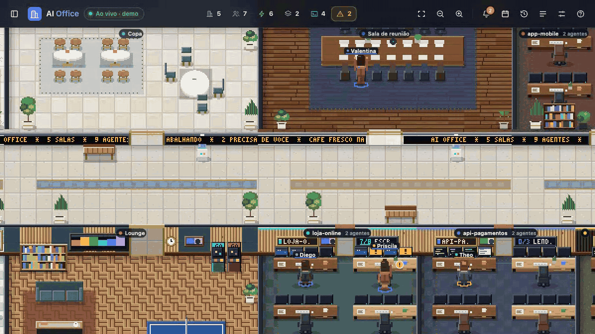
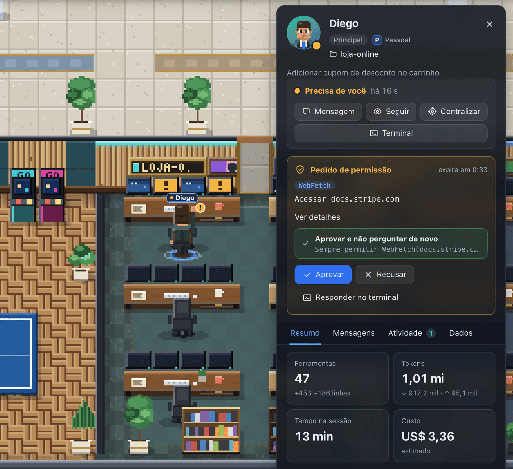
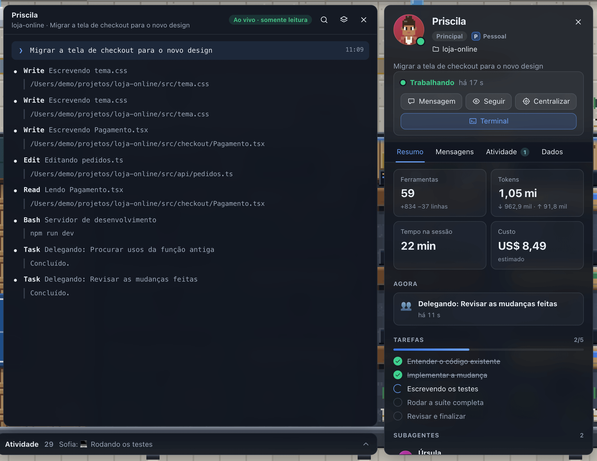
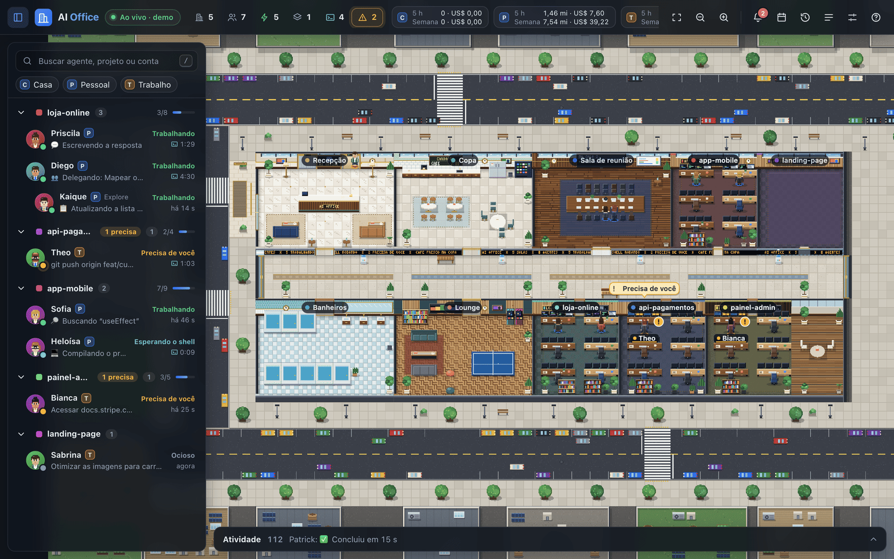
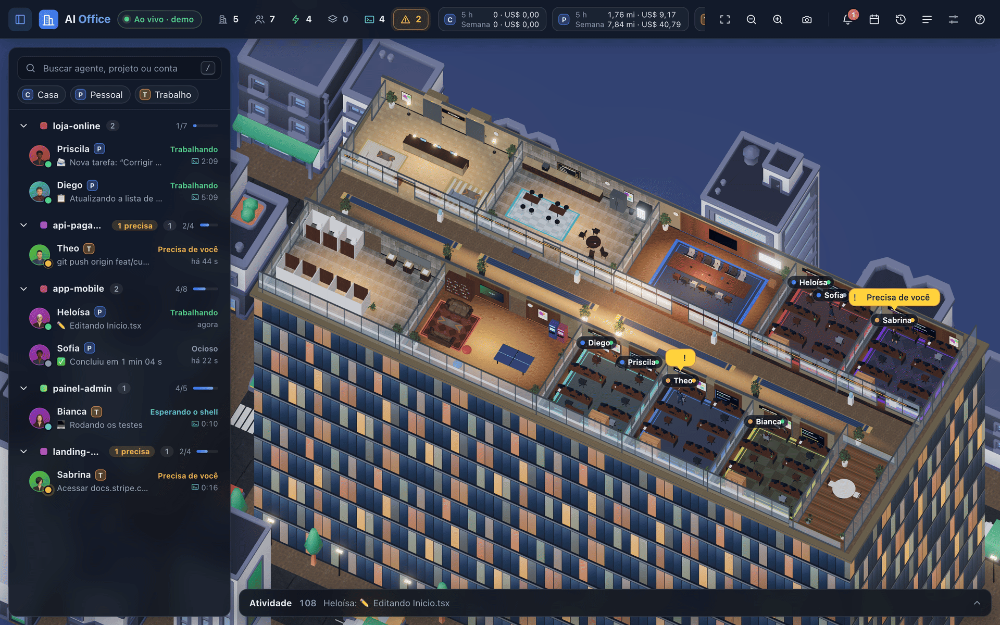

**English** · [Português (Brasil)](README.pt-BR.md) · [Español](README.es.md)

<a id="top"></a>

<p align="center">
  <picture>
    <source media="(prefers-reduced-motion: reduce)" srcset="docs/assets/readme/hero-still.svg" />
    
  </picture>
</p>

# AI Office

**Your Claude Code agents, at work in a live office.**

AI Office turns the Claude Code sessions running on your computer into a corporate office you can watch in real time. Every project becomes a room, every session is a person at a desk, and subagents are colleagues who walk into the meeting room, work and leave.

You see who is working, who needs you and who is waiting on a shell. You answer permission requests, send instructions and review your day without switching terminals. **Everything runs on `127.0.0.1`; nothing leaves your computer.**

<p align="center">
  <a href="#install"><strong>INSTALL WITH ONE PROMPT →</strong></a>
  &nbsp; · &nbsp;
  <a href="#try-the-demo">TRY THE DEMO</a>
  &nbsp; · &nbsp;
  <a href="#views">SEE IT IN 3D</a>
  &nbsp; · &nbsp;
  <a href="docs/README.md">READ THE DOCS</a>
</p>

<p align="center">
  <a href=".github/workflows/ci.yml"></a>
  &nbsp;
  <a href="LICENSE"><strong>MIT</strong></a>
  &nbsp; · &nbsp;
  <a href="#community">Star History</a>
  &nbsp; · &nbsp;
  <a href="docs/06-validation.md">Evidence and limits</a>
</p>

<p align="center">
  <strong>Claude Code</strong> CLI + desktop / several accounts / <strong>macOS + Linux</strong>
  <br />
  <strong>2D pixel art</strong> by default / optional <strong>3D</strong> / 100% local
</p>

---

<a id="start-here"></a>

## 00 / Choose where to start

| Your situation | Path | What you get |
|---|---|---|
| **I want to see it first** | [Run the demo](#try-the-demo) | A full office with simulated agents, no Claude Code needed |
| **I want my agents in the office** | [Install with one prompt](#install) · [Prompt 01](docs/prompts/01-install-and-run.md) | Server running, plugin installed, office open in your browser |
| **I want it always on** | [Prompt 02](docs/prompts/02-run-at-login.md) | AI Office starts at login (launchd on macOS, systemd on Linux) |
| **I use more than one Claude account** | [Prompt 04](docs/prompts/04-multiple-accounts.md) | Every account in the same office, plugin installed in each one |
| **Something is not working** | [Troubleshooting](docs/08-troubleshooting.md) · [Prompt 05](docs/prompts/05-troubleshoot.md) | A read-only diagnosis first, then fixes you approve |
| **I want to contribute** | [Contributing](CONTRIBUTING.md) · [Prompt 07](docs/prompts/07-contribute.md) | Dev setup, checks and conventions |

**On this page:** [Install](#install) · [Agents](#watch) · [Permissions and messages](#direct) · [2D and 3D](#views) · [How it works](#how-it-works) · [Privacy](#privacy) · [Prompts](#prompts) · [Configuration](#configuration) · [Evidence](#evidence) · [Repository](#repository) · [Community](#community).

<a id="install"></a>

## 01 / Install with one prompt

Open Claude Code (or Codex, or any agent with terminal access) in any folder and paste:

```text
Read https://raw.githubusercontent.com/tfavareto/ai-office/main/docs/prompts/01-install-and-run.md and execute the entire block in the "Prompt" section on this computer.
```

The agent follows a fixed recipe and asks before anything destructive:

1. **Check:** Node.js 22 or newer, npm, git and the `claude` CLI.
2. **Get the code:** clone this repository (default `~/ai-office`), then `npm install` and `npm run build`.
3. **Start:** run the server in the background and confirm `http://127.0.0.1:4848/api/health` answers.
4. **Connect:** install the Claude Code plugin in every account it finds.
5. **Open:** the office in your browser, and offer to start it at login.

<a id="manual-install"></a>

### Prefer to do it by hand?

```bash
git clone https://github.com/tfavareto/ai-office.git
cd ai-office
npm install
npm run build
npm start                 # http://127.0.0.1:4848
```

In a second terminal, connect Claude Code:

```bash
npm run plugin:install    # also: plugin:status, plugin:uninstall
```

Sessions that were already open pick the plugin up after `/reload-plugins` or a restart. The [installation guide](docs/01-installation.md) covers updates, run at login and uninstalling.

<a id="try-the-demo"></a>

### Try the demo

```bash
AI_OFFICE_DEMO=1 npm start
```

Demo mode fills the office with realistic simulated sessions: people walk in, work, ask for permissions and finish. You can also turn it on later in **Configurações** (settings).

<a id="watch"></a>

## 02 / See every agent at a glance

<p align="center">
  
</p>

The office reads what Claude Code already writes to disk and keeps up as it changes. There is nothing to configure per project.

| In Claude Code | In the office |
|---|---|
| A project you opened | A room with its own color, desks and task progress |
| A session | A person at a desk, with name, account and current activity |
| A subagent | A colleague who joins the meeting room and leaves when done |
| A long shell command | A cyan light and a timer, so you know it is not stuck |
| Several accounts | Usage per account: 5-hour window, week and today, in tokens and estimated cost |

Statuses are always shown with text as well as color:

| Status | Meaning |
|---|---|
| 🟢 **Trabalhando** (working) | The turn is in progress |
| 🟠 **Precisa de você** (needs you) | A permission, a question or a plan is waiting for you |
| 🔵 **Esperando o shell** (waiting on the shell) | A command is still running |
| ⚪ **Ocioso** (idle) | The turn ended; the session is open |
| 🔷 **Concluído** (done) | A subagent finished and is leaving the office |

Click a person to see their summary, tasks, subagents, activity and session data. **Meu dia** (my day) shows how long each agent spent in each status today, and the session history keeps the last seven days. The [user guide](docs/02-using-the-office.md) covers every panel and keyboard shortcut.

<a id="direct"></a>

## 03 / Answer and direct them without leaving the office

<p align="center">
  <picture>
    <source media="(prefers-reduced-motion: reduce)" srcset="docs/assets/readme/plugin-flow-still.svg" />
    
  </picture>
</p>

The `ai-office` plugin adds Claude Code hooks that talk to the local server. If AI Office is not running, the hooks exit at once and Claude Code behaves exactly as before.

| You want to | In the office | What reaches Claude Code |
|---|---|---|
| **Approve a tool** | **Aprovar** or **Aprovar e não perguntar de novo** (approve and remember) | The decision, as if you had answered in the terminal |
| **Refuse a tool** | **Recusar**, with an optional reason and interrupt | The refusal and your reason |
| **Steer an agent** | Type in **Mensagens** (messages), or pick a quick message | Your text after its next tool call, or as a new instruction when its turn ends |
| **Talk to a whole room** | The room's team message | One message per agent, tracked as "2 de 3 entregues" (2 of 3 delivered) |
| **Follow the conversation** | The read-only terminal (`T`) | Nothing: it only reads |

The terminal dialog keeps working: whichever answer comes first wins. Every message shows its state: **Na fila** (queued), **Entregue durante o trabalho** (delivered while working), **Entregue como nova instrução** (delivered as a new instruction) or **Expirou** (expired after 2 hours).

<table>
  <tr>
    <td width="50%"></td>
    <td width="50%"></td>
  </tr>
  <tr>
    <td align="center"><sub>Permission requests appear on top of the agent's card</sub></td>
    <td align="center"><sub>The read-only terminal follows any session live</sub></td>
  </tr>
</table>

The [plugin guide](docs/03-plugin.md) details each hook, the delivery paths and the 10-minute stand-by.

<a id="views"></a>

## 04 / 2D by default, 3D when you want it

<table>
  <tr>
    <td width="50%"></td>
    <td width="50%"></td>
  </tr>
  <tr>
    <td align="center"><sub>2D pixel art, the default</sub></td>
    <td align="center"><sub>3D, one click away in the settings</sub></td>
  </tr>
</table>

Both views share the same building, the same people and the same interface; only the rendering changes. Switch in **Configurações → Visual**, and it applies at once.

| | 2D (default) | 3D (optional) |
|---|---|---|
| **Look** | Hand-made pixel art: walnut, marble, brass, plants and a city around the building | Lit 3D tower with real-time shadows, glass, city traffic and 3D characters |
| **Camera** | Pan, zoom and overview | **Visão geral** (overview), **Primeira pessoa** (first person) and **Sobre o ombro** (over the shoulder) |
| **Day and night** | Follows your local time, or fixed day or night | Same, with night glow on the windows and signs |
| **Cost** | Very light: hundreds of frames per second of headroom | Heavier, mainly at night: [measured numbers](docs/06-validation.md) |
| **Loads** | Immediately | On demand, the first time you switch |

<a id="how-it-works"></a>

## 05 / How it works

<p align="center">
  <picture>
    <source media="(prefers-reduced-motion: reduce)" srcset="docs/assets/readme/how-it-works-still.svg" />
    
  </picture>
</p>

1. **Read:** the server watches the session registry and conversation files of every Claude Code account on this computer, read-only.
2. **Understand:** it derives each agent's status, activity, tasks, subagents, shells, tokens and estimated cost.
3. **Stream:** the office receives a live snapshot over Server-Sent Events and animates the change.
4. **Act:** plugin hooks deliver your permission answers and messages back to the right session.

| Package | Role |
|---|---|
| [`packages/server`](packages/server/README.md) | Node.js HTTP server with no framework: reading, status, HTTP and SSE API, the web app |
| [`packages/web`](packages/web) | The interface, the 2D world (Canvas 2D) and the 3D world (three.js, loaded on demand) |
| [`packages/plugins`](packages/plugins/ai-office/README.md) | The Claude Code plugin (hooks) and its installer |
| [`packages/shared`](packages/shared) | Types, protocol and the demo simulator shared by everything |

The [architecture guide](docs/07-architecture.md) and the [specs](docs/spec/00-product.md) go deeper.

<a id="privacy"></a>

## 06 / Private by design

<p align="center">
  <picture>
    <source media="(prefers-reduced-motion: reduce)" srcset="docs/assets/readme/privacy-still.svg" />
    
  </picture>
</p>

AI Office was built for code you may not want to share. It never sends anything anywhere.

| Protection | How |
|---|---|
| **Local only** | Binds to `127.0.0.1`; any other address is refused unless you opt in with `AI_OFFICE_ALLOW_REMOTE=1` |
| **Read-only on Claude Code** | Reads session files; it never edits them |
| **Authenticated** | A random token in `~/.ai-office/token` (mode 0600); the page gets an HttpOnly cookie, the hooks prove they hold the token |
| **Hardened browser surface** | Strict Content Security Policy, cross-site requests rejected, framing denied |
| **Safe hooks** | Short timeouts; if the server is down, Claude Code continues normally |

Read the [privacy and security guide](docs/05-privacy-and-security.md), and report vulnerabilities privately as described in [SECURITY.md](SECURITY.md).

<a id="prompts"></a>

## 07 / Prompts for every step

Pick a task, open the prompt and paste the indicated block into an agent with terminal access. The [catalog](docs/prompts/README.md) explains each one.

| Goal | Prompt | When to use |
|---|---|---|
| **Install and run** | [01 · Install and run](docs/prompts/01-install-and-run.md) | First time on this computer |
| **Keep it running** | [02 · Run at login](docs/prompts/02-run-at-login.md) | You want the office always available |
| **Stay current** | [03 · Update](docs/prompts/03-update.md) | Pull, rebuild, restart and refresh the plugin |
| **Several accounts** | [04 · Multiple accounts](docs/prompts/04-multiple-accounts.md) | More than one `~/.claude*` folder |
| **Fix a problem** | [05 · Troubleshoot](docs/prompts/05-troubleshoot.md) | Something looks wrong; diagnose before changing |
| **Remove it** | [06 · Uninstall](docs/prompts/06-uninstall.md) | Plugin, service and data, each with confirmation |
| **Contribute** | [07 · Contribute](docs/prompts/07-contribute.md) | Set up the dev loop and ship a tested change |

<a id="configuration"></a>

## 08 / Configure it your way

Defaults work for most people. Set environment variables (or the matching flags) only when you need to:

| Variable | Default | Meaning |
|---|---|---|
| `AI_OFFICE_PORT` | `4848` | HTTP port; the plugin uses the same variable |
| `AI_OFFICE_HOST` | `127.0.0.1` | Bind address; anything else requires `AI_OFFICE_ALLOW_REMOTE=1` |
| `AI_OFFICE_CLAUDE_DIRS` | every `~/.claude*` with sessions | Claude Code folders, one per account, comma-separated |
| `AI_OFFICE_STATE_DIR` | `~/.ai-office` | Names, day records and the local access token |
| `AI_OFFICE_DEMO` | off | Start with demo sessions |
| `AI_OFFICE_LOG` | normal | `quiet` or `debug` |

Interface preferences (2D or 3D, day and night, names, speech bubbles, animation, sounds, browser notifications) live in **Configurações** and are saved in your browser. The [configuration guide](docs/04-configuration.md) lists everything, including hook settings.

<a id="evidence"></a>

## 09 / Evidence and limits

| Check | How |
|---|---|
| **Types** | TypeScript strict across the four packages: `npm run typecheck` |
| **Behavior** | 600+ Vitest tests, including an end-to-end suite that boots the real server: `npm test` |
| **Style** | ESLint and Prettier: `npm run lint` |
| **Build** | Web bundle and server bundle: `npm run build` |
| **Documentation** | Every local link, anchor and README translation checked: `npm run docs:check` |
| **Continuous integration** | All of the above on Ubuntu and macOS, Node.js 22 and 24 |

Frame rate measured in the real app with live sessions (4 agents in 4 rooms), 1440×900 at 2× pixel ratio, vsync off to show the headroom:

| View | Day | Night |
|---|---|---|
| 2D | 427 fps | 385 fps |
| 3D, full quality | 83 fps | 21 fps |

Your screen caps what you see (usually 60 fps). The 3D night scene is the expensive one: its glow pass with anti-aliasing at a 2× pixel ratio accounts for most of the cost. The [validation guide](docs/06-validation.md) records the machine, the method and the known limits, such as cost figures being estimates and Windows not being supported.

<a id="repository"></a>

## 10 / Explore the repository

```text
ai-office/
├── README.md                You are here (also in Português and Español)
├── AGENTS.md                Instructions for coding agents (CLAUDE.md points here)
├── docs/                    Guides, evidence and copyable prompts
│   ├── prompts/             Install, run at login, update, troubleshoot…
│   ├── spec/                Product and technical specification
│   └── assets/readme/       Images used on this page
├── packages/
│   ├── server/              Local HTTP + SSE server
│   ├── web/                 Interface, 2D and 3D worlds
│   ├── plugins/             Claude Code plugin and installer
│   └── shared/              Shared types, protocol, demo simulator
└── scripts/                 Repository checks
```

| Guide | Purpose |
|---|---|
| [Overview](docs/00-overview.md) | The mental model, statuses and principles |
| [Installation](docs/01-installation.md) | Requirements, install, update, run at login, uninstall |
| [Using the office](docs/02-using-the-office.md) | Every panel, setting and shortcut |
| [Plugin](docs/03-plugin.md) | Hooks, permissions, messages and notifications |
| [Configuration](docs/04-configuration.md) | Variables, flags, accounts and demo mode |
| [Privacy and security](docs/05-privacy-and-security.md) | What is read, what is stored, how access is protected |
| [Evidence and limits](docs/06-validation.md) | Checks, measurements and known limits |
| [Architecture](docs/07-architecture.md) | Packages, data flow and design decisions |
| [Troubleshooting](docs/08-troubleshooting.md) | Symptoms, causes and fixes |

### Verify this checkout

```bash
npm install
npm run typecheck && npm run lint && npm test && npm run build
npm run docs:check
```

<a id="community"></a>

## 11 / Follow the project

If AI Office made your agents easier to follow, a star helps other people find it.

<a href="https://www.star-history.com/?repos=tfavareto%2Fai-office&amp;type=date">
  <picture>
    <source media="(prefers-color-scheme: dark)" srcset="https://api.star-history.com/chart?repos=tfavareto/ai-office&amp;type=date&amp;theme=dark" />
    <source media="(prefers-color-scheme: light)" srcset="https://api.star-history.com/chart?repos=tfavareto/ai-office&amp;type=date" />
    
  </picture>
</a>

[Report a bug](https://github.com/tfavareto/ai-office/issues/new/choose) · [Suggest an improvement](https://github.com/tfavareto/ai-office/issues/new/choose) · [Contribute](CONTRIBUTING.md)

The chart is provided by [Star History](https://www.star-history.com) and depends on that service. Screenshots in issues and pull requests should come from demo mode, never from real sessions.

<a id="license"></a>

## Credits and license

The 3D world uses public-domain (CC0) assets from [Poly Haven](https://polyhaven.com), [Kenney](https://kenney.nl) and [MakeHuman](https://www.makehumancommunity.org); see the [asset credits](packages/web/public/assets/3d/CREDITS.md). The 2D pixel art is drawn in code.

Licensed under [MIT](LICENSE). By Thiago Salazar Favareto.

<p align="center">
  <strong>WATCH THEM WORK. STEP IN WHEN IT MATTERS.</strong>
  <br />
  <a href="#top">Back to top ↑</a>
</p>
