[English](README.md) · **Português (Brasil)** · [Español](README.es.md)

<a id="top"></a>

<p align="center">
  <picture>
    <source media="(prefers-reduced-motion: reduce)" srcset="docs/assets/readme/hero-still.svg" />
    
  </picture>
</p>

# AI Office

**Seus agentes do Claude Code, trabalhando em um escritório ao vivo.**

O AI Office transforma as sessões do Claude Code que rodam no seu computador (e as suas sessões do Codex) em um escritório corporativo que você acompanha em tempo real. Cada projeto vira uma sala, cada sessão é uma pessoa em sua mesa, e os subagentes são colegas que entram na sala de reunião, trabalham e vão embora.

Você vê quem está trabalhando, quem precisa de você e quem está esperando um comando no shell. Responde a pedidos de permissão, envia instruções e revisa o seu dia sem trocar de terminal. **Tudo roda em `127.0.0.1`; nada sai do seu computador, a menos que você ligue um recurso opcional.**

<p align="center">
  <a href="#install"><strong>INSTALE COM UM PROMPT →</strong></a>
  &nbsp; · &nbsp;
  <a href="#try-the-demo">EXPERIMENTE A DEMO</a>
  &nbsp; · &nbsp;
  <a href="#views">VEJA EM 3D</a>
  &nbsp; · &nbsp;
  <a href="docs/README.md">LEIA A DOCUMENTAÇÃO</a>
</p>

<p align="center">
  <a href=".github/workflows/ci.yml"></a>
  &nbsp;
  <a href="LICENSE"><strong>MIT</strong></a>
  &nbsp; · &nbsp;
  <a href="#community">Star History</a>
  &nbsp; · &nbsp;
  <a href="docs/06-validation.md">Evidências e limites</a>
</p>

<p align="center">
  <strong>Claude Code</strong> CLI + desktop / <strong>Codex</strong> / várias contas / <strong>macOS + Linux</strong>
  <br />
  <strong>Pixel art 2D</strong> por padrão / <strong>3D</strong> opcional / 100% local
  <br />
  Interface em <strong>English</strong>, <strong>Português</strong> e <strong>Español</strong>
</p>

---

<a id="start-here"></a>

## 00 / Escolha por onde começar

| Sua situação | Caminho | O que você recebe |
|---|---|---|
| **Quero ver primeiro** | [Rodar a demo](#try-the-demo) | Um escritório completo com agentes simulados, sem precisar do Claude Code |
| **Quero meus agentes no escritório** | [Instalar com um prompt](#install) · [Prompt 01](docs/prompts/01-install-and-run.md) | Servidor rodando, plugin instalado e o escritório aberto no navegador |
| **Quero que fique sempre ligado** | [Prompt 02](docs/prompts/02-run-at-login.md) | O AI Office inicia no login (launchd no macOS, systemd no Linux) |
| **Uso mais de uma conta do Claude** | [Prompt 04](docs/prompts/04-multiple-accounts.md) | Todas as contas no mesmo escritório, com o plugin instalado em cada uma |
| **Quero iniciar agentes pelo escritório** | [Comande seu time](#team) | Contrate agentes em mesas vazias, organize a fila, acompanhe o quadro de tarefas e automatize aprovações |
| **Quero saber para onde vão meus tokens e meu tempo** | [Consumo, relatórios e Git](#insights) | Consumo por dia, semana e mês, previsão de limite, relatório do dia, estado do Git por sala, time-lapse |
| **Quero o escritório vivo e com a minha cara** | [Um escritório com personalidade](#delight) | Comemorações, interações, níveis e decoração, personalização, um card para compartilhar |
| **Uso o Codex também, ou trabalho em time** | [Codex e modo time](#reach) | Sessões do Codex no mesmo escritório; vários computadores num só escritório pela rede local |
| **Algo não está funcionando** | [Solução de problemas](docs/08-troubleshooting.md) · [Prompt 05](docs/prompts/05-troubleshoot.md) | Primeiro um diagnóstico somente leitura, depois correções que você aprova |
| **Quero contribuir** | [Contribuindo](CONTRIBUTING.md) · [Prompt 07](docs/prompts/07-contribute.md) | Ambiente de desenvolvimento, verificações e convenções |

**Nesta página:** [Instalação](#install) · [Agentes](#watch) · [Permissões e mensagens](#direct) · [Seu time](#team) · [Consumo e dia](#insights) · [Personalidade](#delight) · [Codex e time](#reach) · [2D e 3D](#views) · [Como funciona](#how-it-works) · [Privacidade](#privacy) · [Prompts](#prompts) · [Configuração](#configuration) · [Evidências](#evidence) · [Repositório](#repository) · [Comunidade](#community).

<a id="install"></a>

## 01 / Instale com um prompt

Abra o Claude Code (ou o Codex, ou qualquer agente com acesso ao terminal) em qualquer pasta e cole:

```text
Leia https://raw.githubusercontent.com/tfavareto/ai-office/main/docs/prompts/01-install-and-run.md e execute o bloco inteiro da seção "Prompt" neste computador.
```

O agente segue uma receita fixa e pergunta antes de qualquer ação destrutiva:

1. **Verificar:** Node.js 22 ou superior, npm, git e a CLI `claude`.
2. **Baixar o código:** clonar este repositório (por padrão em `~/ai-office`), depois `npm install` e `npm run build`.
3. **Iniciar:** rodar o servidor em segundo plano e confirmar que `http://127.0.0.1:4848/api/health` responde.
4. **Conectar:** instalar o plugin do Claude Code em todas as contas que encontrar.
5. **Abrir:** o escritório no navegador, e oferecer iniciá-lo no login.

<a id="manual-install"></a>

### Prefere fazer à mão?

```bash
git clone https://github.com/tfavareto/ai-office.git
cd ai-office
npm install
npm run build
npm start                 # http://127.0.0.1:4848
```

Em um segundo terminal, conecte o Claude Code:

```bash
npm run plugin:install    # também: plugin:status, plugin:uninstall
```

As sessões que já estavam abertas passam a usar o plugin depois de `/reload-plugins` ou de uma reinicialização. O [guia de instalação](docs/01-installation.md) cobre atualização, início no login e desinstalação.

<a id="try-the-demo"></a>

### Experimente a demo

```bash
AI_OFFICE_DEMO=1 npm start
```

O modo demo enche o escritório de sessões simuladas e realistas: as pessoas chegam, trabalham, pedem permissões e terminam. Você também pode ativá-lo depois em **Configurações**.

<a id="watch"></a>

## 02 / Veja cada agente num relance

<p align="center">
  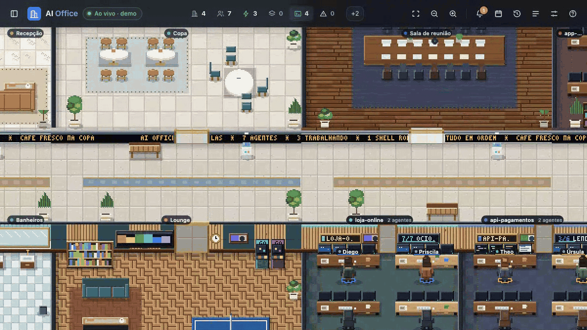
</p>

O escritório lê o que o Claude Code já grava em disco e acompanha as mudanças. Não há nada para configurar por projeto.

| No Claude Code | No escritório |
|---|---|
| Um projeto que você abriu | Uma sala com cor própria, mesas e progresso das tarefas |
| Uma sessão | Uma pessoa em uma mesa, com nome, conta e atividade atual |
| Um subagente | Um colega que entra na sala de reunião e sai quando termina |
| Um comando longo no shell | Uma luz ciano e um cronômetro, para você saber que não travou |
| Várias contas | Uso por conta: janela de 5 horas, semana e hoje, em tokens e custo estimado |

Os status sempre aparecem com texto além da cor:

| Status | Significado |
|---|---|
| 🟢 **Trabalhando** | O turno está em andamento |
| 🟠 **Precisa de você** | Uma permissão, uma pergunta ou um plano está esperando por você |
| 🔵 **Esperando o shell** | Um comando ainda está rodando |
| ⚪ **Ocioso** | O turno terminou; a sessão continua aberta |
| 🔷 **Concluído** | Um subagente terminou e está saindo do escritório |

Clique em uma pessoa para ver o resumo, as tarefas, os subagentes, a atividade e os dados da sessão. **Meu dia** mostra quanto tempo cada agente passou em cada status hoje, e o histórico de sessões guarda os últimos sete dias. O [guia do usuário](docs/02-using-the-office.md) cobre cada painel e atalho de teclado.

<a id="direct"></a>

## 03 / Responda e dê instruções sem sair do escritório

<p align="center">
  <picture>
    <source media="(prefers-reduced-motion: reduce)" srcset="docs/assets/readme/plugin-flow-still.svg" />
    
  </picture>
</p>

O plugin `ai-office` adiciona hooks do Claude Code que conversam com o servidor local. Se o AI Office não estiver rodando, os hooks encerram na hora e o Claude Code se comporta exatamente como antes.

| Você quer | No escritório | O que chega ao Claude Code |
|---|---|---|
| **Aprovar uma ferramenta** | **Aprovar** ou **Aprovar e não perguntar de novo** | A decisão, como se você tivesse respondido no terminal |
| **Recusar uma ferramenta** | **Recusar**, com motivo opcional e interrupção | A recusa e o seu motivo, no seu idioma |
| **Orientar um agente** | Digite em **Mensagens** ou escolha uma mensagem rápida | O seu texto depois da próxima chamada de ferramenta, ou como nova instrução quando o turno terminar |
| **Falar com uma sala inteira** | A mensagem para a equipe da sala | Uma mensagem por agente, acompanhada como "2 de 3 entregues" |
| **Acompanhar a conversa** | O terminal somente leitura (`T`) | Nada: ele só lê |

O diálogo do terminal continua funcionando: vale a resposta que chegar primeiro. Cada mensagem mostra o seu estado: **Na fila**, **Entregue durante o trabalho**, **Entregue como nova instrução** ou **Expirou** (expira após 2 horas).

<table>
  <tr>
    <td width="50%">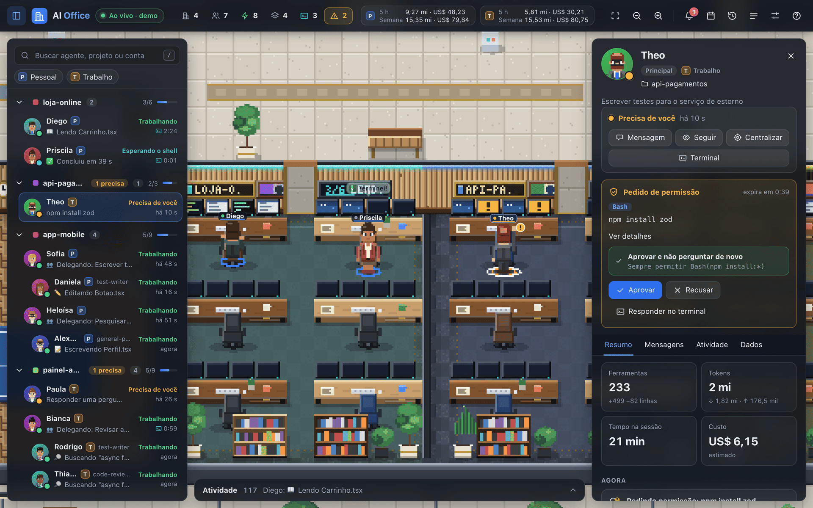</td>
    <td width="50%">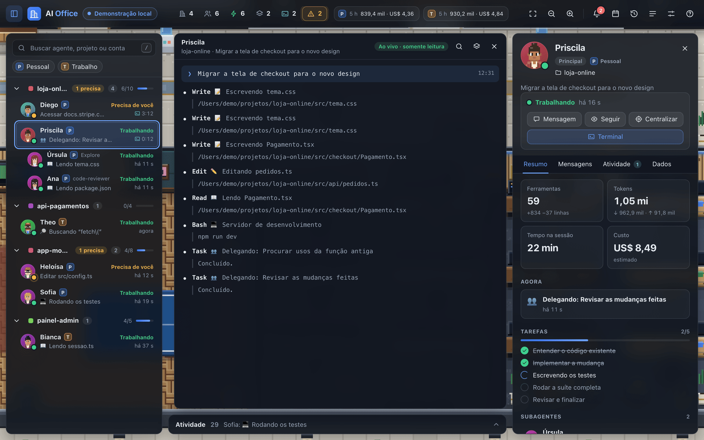</td>
  </tr>
  <tr>
    <td align="center"><sub>Os pedidos de permissão aparecem no topo do cartão do agente</sub></td>
    <td align="center"><sub>O terminal somente leitura acompanha qualquer sessão ao vivo</sub></td>
  </tr>
</table>

O [guia do plugin](docs/03-plugin.md) detalha cada hook, os caminhos de entrega e o stand-by de 10 minutos.

<a id="team"></a>

## 04 / Comande seu time pelo escritório

<table>
  <tr>
    <td width="50%">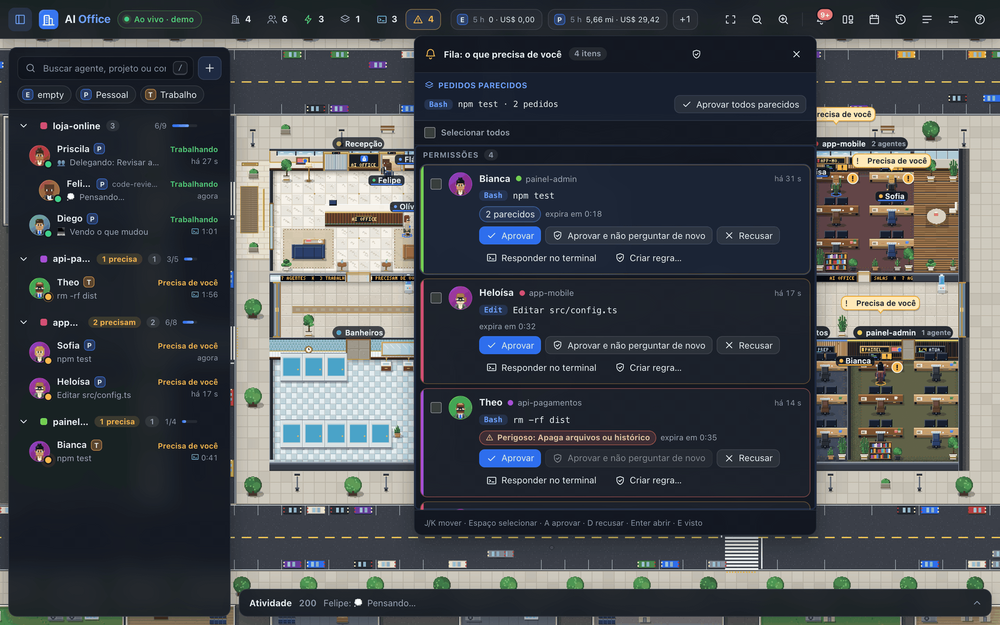</td>
    <td width="50%">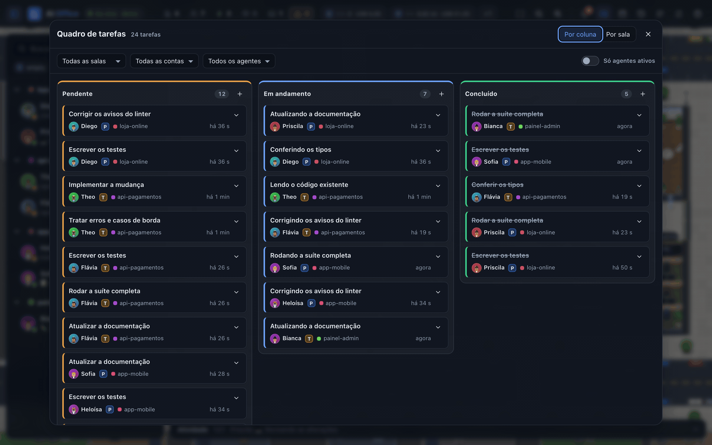</td>
  </tr>
  <tr>
    <td align="center"><sub>Uma só fila para tudo que espera por você</sub></td>
    <td align="center"><sub>As tarefas de todos os agentes num quadro só</sub></td>
  </tr>
</table>

O escritório também é o lugar onde o trabalho começa e continua andando, sem você pular entre terminais.

| Você quer | No escritório | O que acontece |
|---|---|---|
| **Iniciar um novo agente** | Clique numa mesa vazia, em **Contratar agente** numa sala, ou `H` | Abre uma nova janela de terminal com o Claude Code naquela pasta, com a sua primeira tarefa, o modelo e o modo de permissão; uma pessoa caminha até a mesa e assume quando a sessão começa |
| **Zerar o que espera por você** | A **Fila** (`I`) | Permissões, perguntas, erros e agentes que terminaram, em ordem de prioridade; **Aprovar todos parecidos** para pedidos idênticos, triagem pelo teclado e comandos perigosos nunca aprovados em lote |
| **Ver todo o trabalho** | O **Quadro de tarefas** (`K`) ou o quadro branco da sala de reunião | As tarefas de cada agente em **Pendente**, **Em andamento** e **Concluído**; arrastar um cartão escreve uma mensagem ao agente, que você revisa antes de enviar |
| **Parar de responder à mesma pergunta** | **Criar regra…** em qualquer pedido, ou **Configurações → Regras de aprovação** | Pedidos recorrentes (por exemplo, `npm test` num projeto) são respondidos na hora e registrados; comandos perigosos ou compostos sempre vêm até você |

Contratar exige a página aberta neste computador e abre o seu terminal de costume (Terminal ou iTerm no macOS, o terminal do seu desktop no Linux). O [guia de uso](docs/02-using-the-office.md) detalha cada um, e o [guia do plugin](docs/03-plugin.md) explica como as regras respondem aos pedidos.

<a id="insights"></a>

## 05 / Saiba para onde foram seus tokens e o seu dia

<table>
  <tr>
    <td width="50%">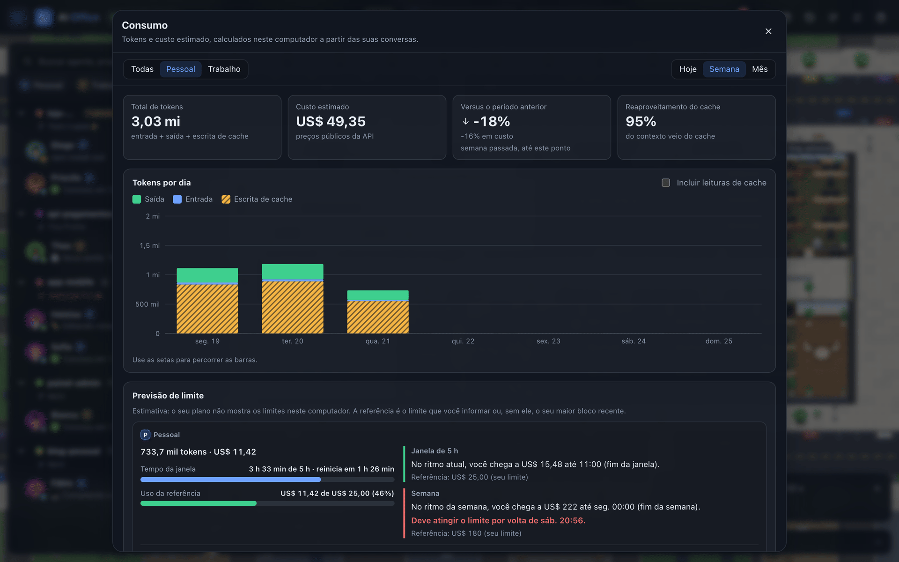</td>
    <td width="50%">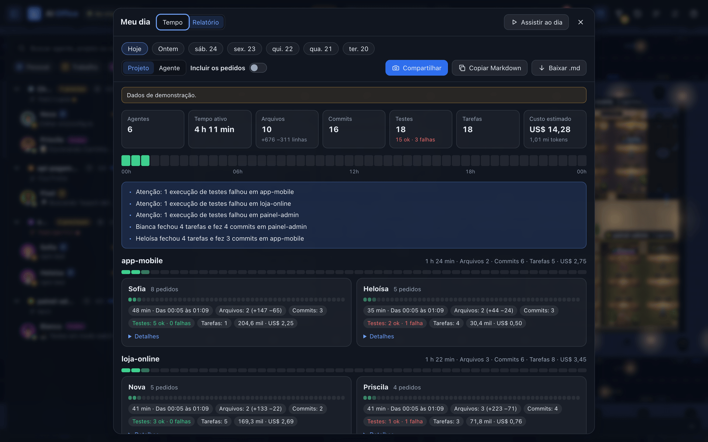</td>
  </tr>
  <tr>
    <td align="center"><sub>Consumo de hoje, da semana e do mês, com previsão de limite</sub></td>
    <td align="center"><sub>Um relatório do dia que você copia ou baixa em Markdown</sub></td>
  </tr>
</table>

Tudo aqui é calculado no seu computador, a partir dos arquivos que o Claude Code já grava.

| Você quer | No escritório | O que você recebe |
|---|---|---|
| **Ver para onde foram os tokens** | Clique num cartão de uso na barra superior, ou `U` | **Consumo** de hoje, da semana e do mês, por conta ou todas: tokens por tipo, custo estimado, variação em relação ao período anterior, reaproveitamento do cache, um gráfico por hora ou dia, e detalhamento por modelo, projeto e sessão |
| **Não esbarrar no limite de surpresa** | **Previsão de limite** no mesmo diálogo | Até onde o seu ritmo atual leva você no fim da janela de 5 h e da semana, e mais ou menos quando você chegaria ao limite; o cartão de uso fica âmbar quando faltam menos de 30 minutos. Os planos não expõem os limites localmente, então informe os seus em **Limites (opcional)** ou a previsão usa o seu maior bloco recente |
| **Escrever o status de hoje** | **Meu dia → Relatório** (`R`) | O que cada agente fez: arquivos alterados, comandos, testes que passaram e falharam, commits, tarefas concluídas, tempo e custo, de hoje ou de qualquer um dos últimos 6 dias; **Copiar Markdown** ou **Baixar .md**. Os seus pedidos ficam de fora, a menos que você os inclua |
| **Saber o estado de cada repositório** | A gaveta da sala, a barra lateral e a placa na porta da sala | Branch, alterações não commitadas, commits à frente e atrás, último commit, rebase ou merge em andamento. Pull requests e status do CI são opcionais e vêm desligados: ligá-los é o único recurso que vai à internet, pelo seu próprio CLI `gh` |
| **Ver o que aconteceu enquanto você estava fora** | **Meu dia → Assistir ao dia** (`L`) | O dia reproduzido no escritório a até 1800× de velocidade, com uma linha do tempo para navegar e marcadores de chegadas, commits, testes que falharam e esperas por permissão |

<p align="center">
  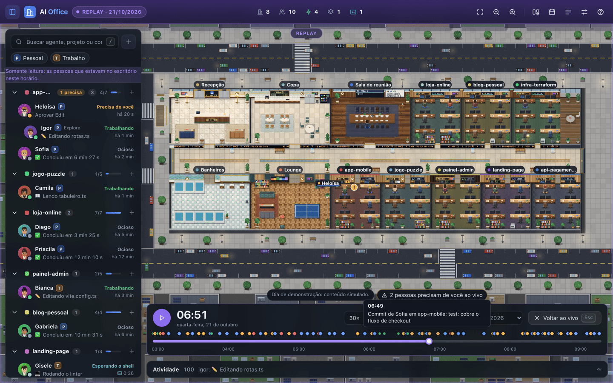
  <br />
  <sub>Assistir ao dia: o escritório reproduzido desde a primeira sessão, com marcadores na linha do tempo</sub>
</p>

O [guia de uso](docs/02-using-the-office.md) detalha cada vista; o [guia de privacidade](docs/05-privacy-and-security.md) lista o que o índice de consumo e o relatório guardam em disco (números por projeto e sessão, nunca o texto das conversas).

<a id="delight"></a>

## 06 / Um escritório com personalidade

<p align="center">
  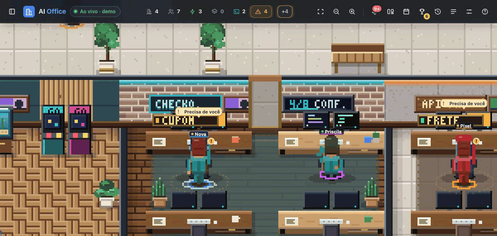
</p>

O escritório reage ao trabalho, não só ao status, e com o tempo fica com a sua cara.

| O quê | Como aparece |
|---|---|
| **As pessoas encenam o trabalho** | Ler segura uma página, editar digita rápido com pequenos símbolos de código, um comando longo no shell faz a pessoa se recostar e batucar, pensar mostra um balão, esperar por você levanta a mão, erros repetidos fazem coçar a cabeça, e agentes ociosos tiram uma pausa para o café |
| **Comemorações** | Testes que passam depois de uma falha, uma lista de tarefas concluída, um commit ou um pull request mesclado soltam confete dos dois lados, um pulo e colegas aplaudindo; uma sala que termina tudo ganha uma chuva de confete. **Configurações → Comemorações**; com movimento reduzido, aparece uma estrela discreta no lugar |
| **Os agentes interagem** | Apertos de mão com subagentes na sala de reunião, conversas no café, pingue-pongue no lounge, "toca aqui" e acenos no corredor; o trabalho de verdade sempre os interrompe |
| **O escritório cresce** | **Conquistas** (`C`): dez níveis do escritório a partir das suas sessões, tarefas, commits, testes e sequências, 22 conquistas, um funcionário do mês e decoração que se desbloqueia nível a nível, de quadros nas paredes e um aquário a um armário de troféus, um letreiro de neon e um gatinho do escritório |
| **Deixe com a sua cara** | **Personalizar** em qualquer agente ou sala: nomes, tom de pele, penteado, roupa e acessórios (iguais em 2D e 3D), por agente, sala ou conta; apelido, piso, paredes, plantas e placa da sala; **Organizar salas** para reordenar, fixar ou ocultar |
| **Compartilhe o seu dia** | **Meu dia → Compartilhar**: uma imagem com a marca do escritório de hoje, com agentes, tempo ativo, tarefas, commits e testes, em 1200×630 ou 1080×1080, clara ou escura, com uma legenda pronta para o LinkedIn ou o X. Os nomes dos projetos e os custos ficam de fora, a menos que você os inclua |

<p align="center">
  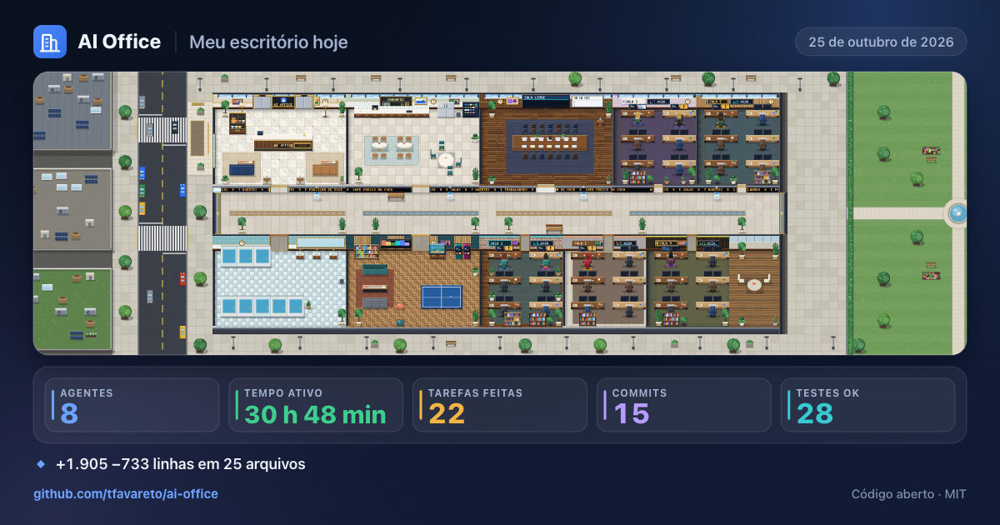
</p>

<a id="reach"></a>

## 07 / Traga o Codex e o seu time

| O quê | Como funciona |
|---|---|
| **Sessões do Codex** | As sessões do Codex CLI e do app desktop da OpenAI (`~/.codex`, ou `CODEX_HOME`) aparecem no mesmo escritório com um selo **Codex**; agentes que trabalham na mesma pasta dividem a sala com os agentes do Claude Code. Status, atividade, consumo, estimativas de custo, o relatório do dia e o time-lapse também as incluem. O Codex não tem hooks, então permissões e mensagens continuam só para o Claude Code: os agentes do Codex são somente leitura. **Configurações → Mostrar sessões do Codex** |
| **Modo time** | Vários computadores num só escritório pela sua rede local. Um computador usa **Hospedar um time** e mostra um código de uso único que expira em 10 minutos; os outros usam **Entrar num time** com o endereço e o código. Vem desligado, num listener separado que só fala o protocolo do time; o pareamento é autenticado, o tráfego é criptografado e o anfitrião pode remover membros a qualquer momento |
| **O que um colega vê** | Nomes, status e o tipo de atividade, em salas somente leitura como "Ana · Projeto 1". Nomes de projetos, detalhes da atividade, branches, tokens e custo só são compartilhados quando cada pessoa liga essa categoria |

A [especificação do modo time](docs/spec/08-team-mode.md) documenta o modelo de ameaças, o protocolo e os seus limites conhecidos; o [guia de privacidade](docs/05-privacy-and-security.md) resume o que sai do seu computador e quando.

<a id="views"></a>

## 08 / 2D por padrão, 3D quando você quiser

<table>
  <tr>
    <td width="50%">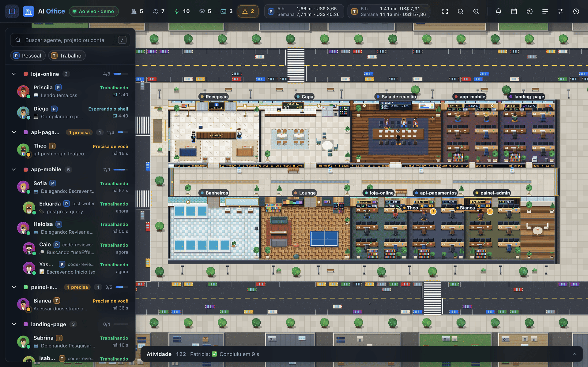</td>
    <td width="50%">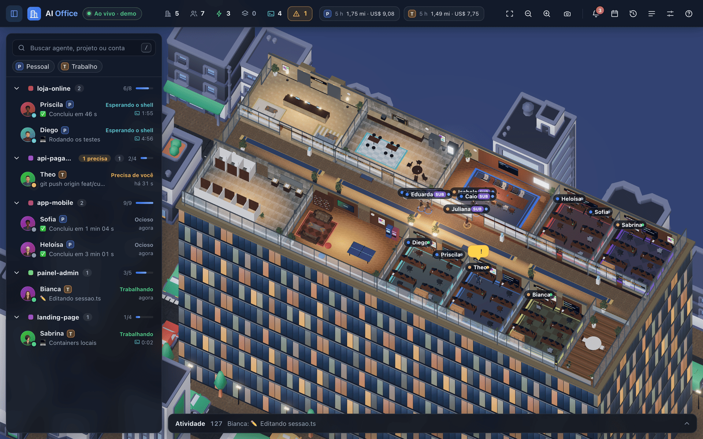</td>
  </tr>
  <tr>
    <td align="center"><sub>Pixel art 2D, o padrão</sub></td>
    <td align="center"><sub>3D, a um clique nas configurações</sub></td>
  </tr>
</table>

As duas vistas compartilham o mesmo prédio, as mesmas pessoas e a mesma interface; muda só a renderização. Alterne em **Configurações → Visual**, e a mudança vale na hora.

| | 2D (padrão) | 3D (opcional) |
|---|---|---|
| **Aparência** | Pixel art feita à mão: nogueira, mármore, latão, plantas e uma cidade ao redor do prédio | Torre 3D iluminada com sombras em tempo real, vidro, trânsito na cidade e personagens 3D |
| **Câmera** | Arrastar, zoom e visão geral | **Visão geral**, **Primeira pessoa** e **Sobre o ombro** |
| **Dia e noite** | Segue o seu horário local, ou dia ou noite fixos | Igual, com brilho noturno nas janelas e nas placas |
| **Custo** | Muito leve: centenas de fps de folga | Mais pesado, principalmente à noite: [números medidos](docs/06-validation.md) |
| **Carregamento** | Imediato | Sob demanda, na primeira vez que você alterna |

<a id="how-it-works"></a>

## 09 / Como funciona

<p align="center">
  <picture>
    <source media="(prefers-reduced-motion: reduce)" srcset="docs/assets/readme/how-it-works-still.svg" />
    
  </picture>
</p>

1. **Ler:** o servidor observa o registro de sessões e os arquivos de conversa de todas as contas do Claude Code neste computador, somente em leitura.
2. **Entender:** ele deduz o status, a atividade, as tarefas, os subagentes, os comandos de shell, os tokens e o custo estimado de cada agente.
3. **Transmitir:** o escritório recebe um snapshot ao vivo por Server-Sent Events e anima a mudança.
4. **Agir:** os hooks do plugin levam as suas respostas de permissão e as suas mensagens de volta à sessão certa.

| Pacote | Função |
|---|---|
| [`packages/server`](packages/server/README.md) | Servidor HTTP em Node.js sem framework: leitura, status, API HTTP e SSE, o app web |
| [`packages/web`](packages/web) | A interface, o mundo 2D (Canvas 2D) e o mundo 3D (three.js, carregado sob demanda) |
| [`packages/plugins`](packages/plugins/ai-office/README.md) | O plugin do Claude Code (hooks) e o seu instalador |
| [`packages/shared`](packages/shared) | Tipos, protocolo e o simulador da demo, compartilhados por todos |

O [guia de arquitetura](docs/07-architecture.md) e as [especificações](docs/spec/00-product.md) vão mais a fundo.

<a id="privacy"></a>

## 10 / Privado por princípio

<p align="center">
  <picture>
    <source media="(prefers-reduced-motion: reduce)" srcset="docs/assets/readme/privacy-still.svg" />
    
  </picture>
</p>

O AI Office foi feito para código que você talvez não queira compartilhar. Ele não envia nada para lugar nenhum, exceto por dois recursos opcionais que vêm desligados: consultar pull requests pelo seu próprio CLI `gh` e o modo time, que compartilha uma visão filtrada com os computadores que você pareia na sua rede local.

| Proteção | Como |
|---|---|
| **Somente local** | Escuta em `127.0.0.1`; qualquer outro endereço é recusado, a menos que você ative com `AI_OFFICE_ALLOW_REMOTE=1` |
| **Números, não conversas** | O índice de consumo e o relatório do dia guardam contagens de tokens, custos, nomes de arquivos e comandos; prompts e respostas nunca são guardados |
| **Somente leitura no Claude Code** | Lê os arquivos de sessão; nunca os edita |
| **Autenticado** | Um token aleatório em `~/.ai-office/token` (modo 0600); a página recebe um cookie HttpOnly e os hooks provam que possuem o token |
| **Superfície do navegador reforçada** | Content Security Policy estrita, requisições entre sites rejeitadas, incorporação em frames bloqueada |
| **Hooks seguros** | Timeouts curtos; se o servidor estiver fora do ar, o Claude Code segue normalmente |

Leia o [guia de privacidade e segurança](docs/05-privacy-and-security.md) e relate vulnerabilidades em particular, como descrito em [SECURITY.md](SECURITY.md).

<a id="prompts"></a>

## 11 / Prompts para cada etapa

Escolha uma tarefa, abra o prompt e cole o bloco indicado em um agente com acesso ao terminal. O [catálogo](docs/prompts/README.md) explica cada um.

| Objetivo | Prompt | Quando usar |
|---|---|---|
| **Instalar e rodar** | [01 · Instalar e rodar](docs/prompts/01-install-and-run.md) | Primeira vez neste computador |
| **Manter rodando** | [02 · Iniciar no login](docs/prompts/02-run-at-login.md) | Você quer o escritório sempre disponível |
| **Manter atualizado** | [03 · Atualizar](docs/prompts/03-update.md) | Baixar, recompilar, reiniciar e atualizar o plugin |
| **Várias contas** | [04 · Várias contas](docs/prompts/04-multiple-accounts.md) | Mais de uma pasta `~/.claude*` |
| **Resolver um problema** | [05 · Solucionar problemas](docs/prompts/05-troubleshoot.md) | Algo parece errado; diagnosticar antes de mudar |
| **Remover** | [06 · Desinstalar](docs/prompts/06-uninstall.md) | Plugin, serviço e dados, cada um com confirmação |
| **Contribuir** | [07 · Contribuir](docs/prompts/07-contribute.md) | Montar o ciclo de desenvolvimento e entregar uma mudança testada |

<a id="configuration"></a>

## 12 / Configure do seu jeito

Os padrões servem para a maioria das pessoas. Defina variáveis de ambiente (ou as flags equivalentes) só quando precisar:

| Variável | Padrão | Significado |
|---|---|---|
| `AI_OFFICE_PORT` | `4848` | Porta HTTP; o plugin usa a mesma variável |
| `AI_OFFICE_HOST` | `127.0.0.1` | Endereço de escuta; qualquer outro exige `AI_OFFICE_ALLOW_REMOTE=1` |
| `AI_OFFICE_CLAUDE_DIRS` | todo `~/.claude*` com sessões | Pastas do Claude Code, uma por conta, separadas por vírgula |
| `AI_OFFICE_STATE_DIR` | `~/.ai-office` | Nomes, registros dos dias e o token de acesso local |
| `AI_OFFICE_DEMO` | desligado | Iniciar com sessões de demonstração |
| `AI_OFFICE_LOG` | normal | `quiet` ou `debug` |

As preferências da interface (idioma, 2D ou 3D, dia e noite, nomes, balões de fala, animação, sons, notificações do navegador) ficam em **Configurações** e são salvas no seu navegador. O [guia de configuração](docs/04-configuration.md) lista tudo, inclusive os ajustes dos hooks.

<a id="language"></a>

### Seu idioma

A interface inteira (painéis, status, atividades, notificações, nomes das salas e as placas dentro do escritório) está disponível em **English**, **Português (Brasil)** e **Español**. Escolha um em **Configurações → Idioma**, ou deixe **Automático (sistema)** para seguir o seu navegador. A troca é instantânea e mantém a sua seleção, os painéis abertos e a câmera.

O texto que vem das suas próprias sessões (prompts, títulos de tarefas, comandos, nomes de arquivos) aparece como foi escrito. Quando você responde a uma permissão ou envia uma mensagem, o plugin fala com o agente no seu idioma.

<a id="evidence"></a>

## 13 / Evidências e limites

| Verificação | Como |
|---|---|
| **Tipos** | TypeScript em modo strict nos quatro pacotes: `npm run typecheck` |
| **Comportamento** | Mais de 3100 testes com Vitest, incluindo uma suíte de ponta a ponta que sobe o servidor de verdade: `npm test` |
| **Estilo** | ESLint e Prettier: `npm run lint` |
| **Build** | Bundle web e bundle do servidor: `npm run build` |
| **Documentação** | Todo link local, âncora e tradução do README verificados: `npm run docs:check` |
| **Integração contínua** | Tudo isso em Ubuntu e macOS, Node.js 22 e 24 |

Frame rate medido no app real com sessões ao vivo (4 agentes em 4 salas), 1440×900 com proporção de pixels 2×, vsync desligado para mostrar a folga:

| Vista | Dia | Noite |
|---|---|---|
| 2D | 427 fps | 385 fps |
| 3D, qualidade máxima | 83 fps | 21 fps |

A sua tela limita o que você enxerga (geralmente 60 fps). A cena noturna em 3D é a mais cara: o efeito de brilho com anti-aliasing em proporção de pixels 2× responde pela maior parte do custo. O [guia de validação](docs/06-validation.md) registra a máquina, o método e os limites conhecidos, como os valores de custo serem estimativas e o Windows não ser suportado.

<a id="repository"></a>

## 14 / Explore o repositório

```text
ai-office/
├── README.md                Você está aqui (também em Português e Español)
├── AGENTS.md                Instruções para agentes de código (o CLAUDE.md aponta para cá)
├── docs/                    Guias, evidências e prompts para copiar
│   ├── prompts/             Instalar, iniciar no login, atualizar, solucionar problemas…
│   ├── spec/                Especificação de produto e técnica
│   └── assets/readme/       Imagens usadas nesta página
├── packages/
│   ├── server/              Servidor HTTP + SSE local
│   ├── web/                 Interface, mundos 2D e 3D
│   ├── plugins/             Plugin do Claude Code e instalador
│   └── shared/              Tipos compartilhados, protocolo, simulador da demo
└── scripts/                 Verificações do repositório
```

| Guia | Para quê |
|---|---|
| [Visão geral](docs/00-overview.md) | O modelo mental, os status e os princípios |
| [Instalação](docs/01-installation.md) | Requisitos, instalação, atualização, início no login, desinstalação |
| [Usando o escritório](docs/02-using-the-office.md) | Cada painel, ajuste e atalho |
| [Plugin](docs/03-plugin.md) | Hooks, permissões, mensagens e notificações |
| [Configuração](docs/04-configuration.md) | Variáveis, flags, contas e modo demo |
| [Privacidade e segurança](docs/05-privacy-and-security.md) | O que é lido, o que é guardado, como o acesso é protegido |
| [Evidências e limites](docs/06-validation.md) | Verificações, medições e limites conhecidos |
| [Arquitetura](docs/07-architecture.md) | Pacotes, fluxo de dados e decisões de projeto |
| [Solução de problemas](docs/08-troubleshooting.md) | Sintomas, causas e correções |

### Verifique este checkout

```bash
npm install
npm run typecheck && npm run lint && npm test && npm run build
npm run docs:check
```

<a id="community"></a>

## 15 / Acompanhe o projeto

Se o AI Office deixou seus agentes mais fáceis de acompanhar, uma estrela ajuda outras pessoas a encontrá-lo.

<a href="https://www.star-history.com/?repos=tfavareto%2Fai-office&amp;type=date">
  <picture>
    <source media="(prefers-color-scheme: dark)" srcset="https://api.star-history.com/chart?repos=tfavareto/ai-office&amp;type=date&amp;theme=dark" />
    <source media="(prefers-color-scheme: light)" srcset="https://api.star-history.com/chart?repos=tfavareto/ai-office&amp;type=date" />
    
  </picture>
</a>

[Relatar um bug](https://github.com/tfavareto/ai-office/issues/new/choose) · [Sugerir uma melhoria](https://github.com/tfavareto/ai-office/issues/new/choose) · [Contribuir](CONTRIBUTING.md)

O gráfico é fornecido pelo [Star History](https://www.star-history.com) e depende desse serviço. Capturas de tela em issues e pull requests devem vir do modo demo, nunca de sessões reais.

<a id="license"></a>

## Créditos e licença

O mundo 3D usa assets em domínio público (CC0) do [Poly Haven](https://polyhaven.com), do [Kenney](https://kenney.nl) e do [MakeHuman](https://www.makehumancommunity.org); veja os [créditos dos assets](packages/web/public/assets/3d/CREDITS.md). A pixel art 2D é desenhada em código.

Licenciado sob [MIT](LICENSE). Por Thiago Salazar Favareto.

<p align="center">
  <strong>VEJA ELES TRABALHAREM. INTERVENHA QUANDO IMPORTAR.</strong>
  <br />
  <a href="#top">Voltar ao topo ↑</a>
</p>
