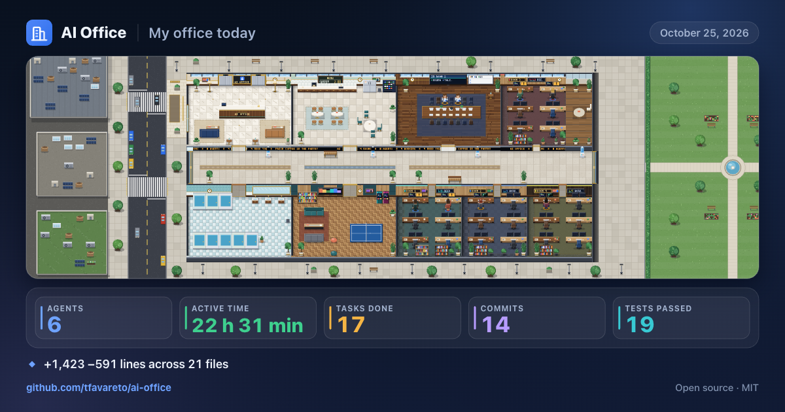
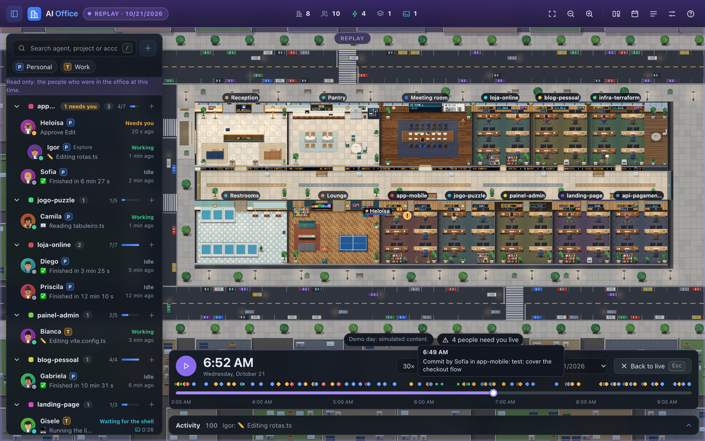

# Using the office

This guide tours the screen: the top bar, the sidebar, the office itself, the details drawer, the inbox, notifications, **My day**, the terminal panel, settings, the interface language, the statuses legend, keyboard shortcuts and the 2D and 3D views.

The interface comes in English, Portuguese (Brazil) and Spanish; this guide quotes the English labels. You can change the language at any time in **Settings → Language** (see [Language](#language)). Some features act on your sessions (permission answers, messages, terminal, session history, demo switch); they only work when the page is opened on the same computer as the server (`localhost` or `127.0.0.1`). Otherwise they show "Only available when AI Office is opened on this computer (localhost)."

## The screen

Dark glass panels float over the office:

- Top bar (full width)
- Sidebar on the left (collapsible with `[`)
- Details drawer on the right (opens when you select something)
- **Activity** feed along the bottom (collapsible with `]`)
- Toasts bottom right

On screens narrower than 900 px the sidebar and drawer become overlays.

When no session is open, a card says **No open sessions** with the steps to start one and a **View in demo mode** button.

## Top bar

| Element | What it does |
| --- | --- |
| Sidebar button | Show or hide the sidebar (`[`). |
| Logo and "AI Office" | Brand. |
| Connection pill | **Live**, **Live · demo**, **Reconnecting…** (the page retries with a growing delay up to 30 s), **Connecting…**, or **Local demo** when you opened `?mock=1`. |
| Counters | **rooms**, **agents**, **working**, **subagents**, **shells running**, **need you**. **Shells running** jumps to the next agent with a shell and is disabled at zero. **Need you** opens the [inbox](#the-inbox-what-needs-you) (`I`); a green pill next to it counts agents that finished since you last looked. |
| Usage cards | One per account: tokens and estimated cost for the **5 h** window and the **Week**. Hover for the tooltip, which adds **Today** and when each window resets. Click a card (or press `U`) to open the detailed **Consumo** view. An amber ring and a small mark mean the limit may be reached in less than 30 minutes. Costs are estimates from public list prices. |
| Overview (O), Zoom out (-), Zoom in (+) | Fit the whole office, zoom out, zoom in. |
| Camera button | 3D only. Cycles **Overview**, **First person** and **Over the shoulder**. |
| Bell | **Notifications** with an unread badge. |
| Board | **Task board** (`K`). |
| Calendar | **My day** (M). |
| Trophy | **Achievements** (`C`): your office level, badges and decoration. A small gold number is the level. |
| History | **Session history**. |
| Feed | **Office activity** (`]`). |
| Gear | **Settings**. |
| Question mark | **Help and shortcuts** (`?`). |

The browser tab title shows **(n) AI Office** while *n* agents need you.

## Sidebar

- **Search** (`/` focuses it): filters agents, projects and accounts. Arrow keys move through results; `Esc` clears the search.
- **Account chips**: filter the list by account when you have more than one. Codex sessions have their own **Codex** chip.
- **Rooms** list: each room can be collapsed and shows how many of its agents need you, and its Git branch (with a dot while work is uncommitted). Click a room to select it and move the camera there.
- **Agent rows**: avatar with a status dot, name, account chip, role, current activity and how long ago the status changed. For an agent waiting on a shell, the time is the shell's elapsed time. Subagents are indented under their parent. Click selects and focuses; people who are leaving fade out.

## The office

| Gesture | Effect |
| --- | --- |
| Hover a person or room | A small tip: for a person, the name, role, status and current activity; for a room, the project name, how many people are in it and its path. |
| Hover an empty desk | A dashed outline with a "+" and the tip **Free desk** (only when the page is opened on this computer). |
| Click a person or room | Select it and open the drawer. |
| Click an empty desk | Open **Hire an agent** for that room (see [Hiring an agent](#hiring-an-agent)). |
| Double-click | Focus the camera on it. |
| Drag, `W` `A` `S` `D`, arrow keys | Pan. Hold `Shift` to pan faster. |
| Mouse wheel, `+`, `-` | Zoom. 2D zooms in whole steps to keep the pixel art sharp. |
| `O` | **Overview**: fit the whole office. |
| `F` | **Follow**: keep the camera on the selected agent. |

People react to their status and to what their agent is doing. **Working** people sit at their desk: they read a page when the agent reads files, type fast with tiny code glyphs when it edits, lean back at a glowing screen while a shell command runs (and stretch and yawn if it takes long), show a pulsing globe on the web, a thought bubble while it thinks, point toward the meeting room while it delegates to subagents, and scratch their head with a "?" after repeated errors. Good moments are celebrated with confetti (see [Celebrations](#celebrations)); people also greet each other, wave in the corridor, chat at the pantry with icon-only bubbles and play ping-pong. Anything that needs you cancels these breaks at once. Subagents work at the meeting table. **Needs you** people stand with a raised hand and a bubble reading "Needs you". Idle people walk to the pantry or the lounge and chat. People waiting for a shell lean back and watch their screen. Finished or offline people walk to the elevator and leave. Speech bubbles show what an agent is doing; you can limit them in settings.

## Details drawer: an agent

Select a person to open the drawer.

**Header.** Avatar, name, kind (**Main** or the subagent's role), account chip and a link to the room. Below it, the session title, the current status with how long ago it began, and five actions:

| Action | Effect |
| --- | --- |
| **Message** | Opens the **Messages** tab with the composer focused (`N`). |
| **Follow** | Camera follows the agent (`F`). |
| **Center** | Moves the camera to the agent once. |
| **Terminal** | Opens the read-only terminal panel (`T`). |
| **Customize** | Opens the [personalization](#personalization) editor for this agent. |

**Urgent cards** always sit at the top:

- **Permission request**: the tool, a one-line summary, **Show details** (the tool input) and a countdown ("expires in"). Buttons: **Approve**; **Approve and don't ask again**, one per rule Claude Code suggested, which also saves that rule; **Deny**, which reveals an optional reason the agent will read and a checkbox **Interrupt the agent's turn**, confirmed with **Confirm denial**; and **Answer in the terminal**, which hands the decision back to the terminal dialog. The first answer wins, whether it comes from the office or the terminal.
- **Needs you**: shown when the agent waits on something the office cannot answer (a question or plan approval, or a notification). Its button opens the terminal panel; you answer in the terminal where the session runs.
- **Waiting for the shell**: lists running commands with elapsed time and a stage (**Starting**, **Running**, **Taking a while**, **Long run**) that advances at 5 s, 1 min and 5 min.

**Tabs** (arrow keys switch between them):

| Tab | Content |
| --- | --- |
| **Summary** | Tiles for **Tools**, **Tokens**, **Time in session** and **Cost** (estimated); **Now** (the current activity); **Tasks** (the agent's task list with progress); **Subagents** (for a main agent) or **Owner** (for a subagent). |
| **Messages** | **Send an order** composer with quick chips, and the **History** of messages with their delivery status. |
| **Activity** | Running shells and a timeline of recent activities. |
| **Data** | Account, room, kind, model, branch, permission mode, session id (copyable), start, duration, tools, input and output tokens, changed lines, subagents created, estimated cost. |

### Sending messages

The composer takes up to 4000 characters. Four quick chips insert common instructions ("How is it going? Give me a quick summary.", "Stop and explain the plan to me before continuing.", "Run the tests before continuing.", "You can wrap up and send me a summary."). Send with **Send** or `Cmd+Enter` / `Ctrl+Enter`. The message is delivered exactly as written; the plugin only phrases its own preamble in your interface language (see [the plugin guide](03-plugin.md#messages-to-agents)). Each message shows a status:

| Status | Meaning |
| --- | --- |
| **Queued** | Waiting for the agent's next hook. |
| **Delivered while working** | Added to the agent's context after a tool call. |
| **Delivered as a new instruction** | Delivered when the agent finished its turn; it continues with the message as its next instruction. |
| **Expired** | Not picked up within 2 hours. |

Messages need the [plugin](03-plugin.md#messages-to-agents). A message to an agent that has left the office is not accepted.

## Details drawer: a room

Select a room (click it, or its row in the sidebar). The drawer shows the room color and project name (with a button to copy the path), counts for agents, working and needing you, the **Accounts** present, the **Agents** list, a **Customize** button (see [Personalization](#personalization)), a team composer (**Send to the team**), **Git** (see below), **Tasks** from every agent's plan and **Recent activity**. A team message goes to every agent in the room (up to 24) and its history reads like "2 of 3 delivered".

### Git

When the room's folder is a Git repository, the drawer has a **Git** section and the office shows the same state elsewhere. It is read-only: AI Office never fetches, commits or changes anything.

- **Branch**, with a button that copies its name. A badge says when a rebase, merge, cherry-pick, revert or bisect is in progress, or that HEAD is detached.
- **Changes**: files with conflicts, staged, modified and new files, and the lines added and removed.
- **Ahead and behind**: `↑2 ↓1` against the branch's upstream; "up to date with origin/main", or a note that the branch has no upstream.
- **Last commit** (hash, subject and age) and the number of stashed entries.
- **Pull request** (only if you turned it on, see below): its number and title as a link that opens it in your browser, whether it is open, draft, merged or closed, the review decision, a CI badge (green passing, amber running, red failing) and how many checks passed, with the names of the failing ones.

The sidebar shows the branch under each room's name, with a dot while there is uncommitted work (red during a rebase, merge...). Hovering a room shows its branch in the tip and on its label on the map. In the office, each room has a small **plaque under its sign** with the branch and a marker (green clean, amber uncommitted work, red conflicts or an operation in progress); in 3D the plaque also names the operation and the commits ahead or behind. When the branch has an open pull request, a **CI light** (green, red or amber) sits on the plaque. Folders that are not repositories show none of this.

Pull requests and CI come from GitHub through your own [`gh`](https://cli.github.com/) CLI. This is **off by default** because it is the only feature that uses the internet: turn it on in **Settings → Look up pull requests with gh (uses the internet)**. `gh` must be installed and signed in (`gh auth login`); Settings tells you when it is not. See [privacy and security](05-privacy-and-security.md#git-and-pull-requests).

## The inbox: what needs you

The **need you** counter in the top bar (or `I`) opens one list with everything that waits on you, so you can triage it without hunting through rooms. It floats between the sidebar and the drawer, so you can keep an agent open next to it, and it stays open until you press `Esc`, `I` or the counter again.

Items come in this order:

1. **Permissions**: pending requests, the one that expires first on top. Each shows the agent and room, the tool, what it wants to do and a countdown. Buttons: **Approve**, **Approve and don't ask again** (also saves the first rule Claude Code suggested), **Deny** (with an optional reason the agent reads) and **Answer in the terminal**.
2. **Questions and notices**: the agent waits for an answer or an approval that only the terminal can give. Open the agent or its terminal; you answer there.
3. **Errors**: the agent's last action failed.
4. **Finished**: agents that went idle after working since you last looked. Opening the agent, or **Mark as seen**, clears them. Seen marks are kept in this browser only.

The inbox is empty most of the time: "Nothing needs you right now".

### Triage in bulk

Tick the checkboxes (`Shift` + click selects a range) and use **Approve selected** or **Deny selected**. Identical requests, for example the same `npm test` from three agents, are offered together under **Similar requests** with **Approve all similar**; edits to files of the same folder and type, and fetches from the same host, count as similar too. Every bulk action first shows what it will do and what it leaves out, and waits for **Confirm**.

Dangerous requests (deleting files recursively, `sudo`, forced pushes, hard resets, recursive `chmod`, piping a download into a shell, wiping disks or databases, writing to secrets or system files) carry a **Risky** badge. They are never part of a bulk approval or a similar group, and cannot be remembered as a rule: approve them one by one, with the button.

### Inbox keys

| Key | Action |
| --- | --- |
| `J` / `K` or arrows | Move between items. |
| `Space` | Select the item. |
| `A` | Approve the request (or the selection, after confirming). |
| `Shift+A` | Approve and don't ask again. |
| `D` | Deny; `Enter` confirms, with an optional reason. |
| `Enter` | Open the agent. |
| `E` | Mark as seen. |
| `Esc` | Cancel the confirmation or deny box, then close the inbox. |

## Approval rules

Some requests come again and again: `npm test`, edits in `src/`, a documentation site. An **approval rule** teaches the office to answer them for you, and to say so.

**Create one from a request.** On a permission card or an inbox row, press **Create rule…**. The dialog opens with the rule filled in from the request: the tool, the command's first words (`npm test`, `npm run build`, `git status`) or the folder of the file (`src/**`) or the website, for this project. Change anything, and read the line under the form: "This rule would have answered 3 of today's 12 requests." Press **Save rule**. For a dangerous request the suggestion is a **deny** rule instead.

**Manage them.** **Settings → Approval rules → Manage…**, or the shield button in the inbox, opens the **Rules** tab: what each rule does (it approves or denies), the tool and what it matches, where it applies (all projects, or one project; optionally one account), how many times it fired and when it last did. Use the switch to turn a rule off, **Edit** to change it, **Delete** to remove it (after a confirmation) and **See log** for its decisions. A rule can carry a note; when it denies, the agent reads the note as the reason.

**What a rule can match.**

| Matcher | Tools | Example |
| --- | --- | --- |
| Command starts with | Bash | `npm test` matches `npm test -- --watch`, not `npm testx` and not `npm test; rm -rf /`. |
| Path (pattern) | Edit, Write, Read... | `src/**` (any depth), `src/*.ts` (one folder). Patterns never match dot files such as `.env`. A relative path starts at the project. |
| Website | WebFetch | `docs.stripe.com` or `*.stripe.com`. |
| Exactly | Bash, file tools, WebFetch, WebSearch | The whole command, file, address or query. |
| Any request of the tool | Read-only tools, one MCP tool or server (`mcp__docs__*`) | Every request of that tool. |

**Which rule wins.** A matching **deny** rule beats every allow rule. Among rules that do the same thing, the one with the most specific scope wins (a project rule beats an all-projects rule). Turned-off rules are ignored. A request no rule matches reaches you as always.

**Safety.** Dangerous requests (deleting files recursively, `sudo`, forced pushes, hard resets, piping a download into a shell, wiping disks, writing secrets or system files, running inline code such as `bash -c`) are **never approved by a rule**, even when one matches: you are asked, and the log says why. Allow rules also only match single commands, never ones chained with `;`, `&&`, `||`, `|`, backticks, `$(` or redirections. When you try to save an allow rule that would cover dangerous commands (`any` on Bash, `rm`, `sudo`, `git push`...) or compound ones, the dialog refuses and explains. See [Privacy and security](05-privacy-and-security.md#approval-rules).

**The log.** The **Log** tab lists the last 500 automatic decisions, newest first: approved, denied, or "asked you" (the rule matched but the request was risky), with who asked, what, and which rule answered. Filter by result, by text or by rule; **Clear log** erases it. Each automatic answer also leaves a quiet line in the agent's activity ("Rule approved: npm test"). Rules work in demo mode too.

## Personalization

Make the office yours. Everything stays on your computer (in `customization.json`, see [what AI Office stores](05-privacy-and-security.md#what-ai-office-stores)) and every browser tab shows it, share card included. It needs a page opened on this computer, like hiring.

**An agent.** Select someone and press **Customize** (or use the same button on a room's row in the sidebar for the room). The editor shows a live portrait, drawn by the visual you are using, and lets you:

- **Rename** the agent (up to 32 characters, no control characters). Leave the name empty to bring back the one the office picked.
- Choose the **skin tone**, **hair style** (four per look), **hair color**, **outfit** color and **accessory** (glasses, headphones, a cap, or none). **Automatic** leaves a part to the default, which is drawn from the agent's session as always. The same choices are drawn in 2D and in 3D.
- Decide **where the look applies**: this agent only, everybody in its room (a team color: "everyone here wears teal") or everybody on its account. An agent's own choices win over its room's, and the room's over the account's. A subagent wears what its main agent's room and account give unless you customize it itself.

**A room.** The **Customize** button of a room offers the **name shown** (the project does not change; leave it empty for the folder's name), a **color**, **floor** (wood, carpet, tiles, concrete), **wall** (wood slats, smooth plaster, brick, raw concrete), **plants** (few, normal, many), the **sign** (brass, neon, wood, minimal), the team's outfit, **Pin to the front** and **Hide from the building**. Only that room is redrawn.

**The order of the rooms.** **Settings → Personalization → Arrange rooms…** (or the same button when you customize a room) shows the slots of the building: the north row, the corridor and the south row, with each room in its slot. Drag rooms on the plan or in the list, or use the up and down buttons (they work with the keyboard). Pinned rooms take the first slots; a hidden room leaves the building (its people walk out through the elevator) but stays in the sidebar with an eye icon. **Restore order** puts the rooms back in the order they arrived.

**Resetting.** **Restore default** in an editor resets that agent or room. **Settings → Personalization** lists everything you changed with a reset button for each item, and **Restore everything** (asks you to confirm) clears it all. In demo mode a few agents and rooms come customized, so you can see the effect; your own choices go on top.

## Hiring an agent

The office is also a place to start work. Use any of these:

- click an **empty desk** in a room (the desk you click is where the new person will sit);
- the **Hire agent** button in a room's drawer, or the **+** on a room row in the sidebar;
- the **+** next to the sidebar search, the **Hire agent** button on the empty-state card, or the `H` key (with a room selected it starts in that room).

The dialog asks for:

| Field | Notes |
| --- | --- |
| **Project** | A room already in the office, or **New project…** to start in a folder that has no room yet: type its full path (`~` works) and the field tells you whether the folder exists; **Recent folders** come from your session history. |
| **Account** | Shown when you have several accounts. It starts on the account that most recently worked in that room, else the default account. |
| **First task** | Optional, up to 8000 characters. Claude Code receives it as its first prompt. |
| **Model** | Claude Code's default, or Opus, Sonnet or Haiku. |
| **Permission mode** | Default (asks before editing or running commands), Accept edits, or Plan first. |

Press **Hire** (or `Cmd+Enter` / `Ctrl+Enter`). AI Office opens a **new terminal window** (Terminal.app on macOS, iTerm2 if that is the terminal you have open; on Linux the first of `x-terminal-emulator`, `gnome-terminal`, `konsole`, `xfce4-terminal`, `xterm`) running Claude Code in the project folder. You use that window like any other Claude Code session; the office follows it as usual.

Until the session starts, a person tagged **arriving…** walks in from the elevator and sits at the desk. When the session appears (usually a few seconds, up to 90 s) that same person becomes the agent, and a bubble says it has arrived. If nothing shows up in 90 s you get a notice: the terminal may be waiting for you (for example a "trust this folder" question).

Good to know:

- If the dialog says it could not open the terminal, on macOS allow AI Office's host app (your terminal or Node) to control Terminal under **System Settings → Privacy & Security → Automation**. If it says it cannot find `claude`, install Claude Code and check that `claude` works in a terminal (AI Office also looks in `~/.local/bin` and `~/.claude/local`).
- At most five agents can be hired per minute.
- In **demo mode** nothing is launched: a simulated agent arrives instead. The feature only works when the page is opened on the computer that runs AI Office. See [Privacy and security](05-privacy-and-security.md#hiring-an-agent) for what it can launch.

## The task board

The **Task board** (`K`, the board button of the top bar, or a click on the whiteboard of the meeting room) shows the tasks of every agent in one place: what Claude Code writes in its task list (TodoWrite, TaskCreate, TaskUpdate). It is a view, not a project manager: AI Office never edits a task list itself.

- **Columns.** **Pending**, **In progress** and **Completed**. A card shows the task (the "doing…" form while in progress), the agent, its account, the room and how long ago the task reached its status. Switch **By column** or **By room** (one lane per room).
- **Filters.** Room, account (when you have several), agent and **Active agents only** (working, waiting for you or running a shell).
- **Completed cards.** Each room keeps its last three; **See all** shows the rest.
- **Open a task.** Click a card: the camera frames the agent and its drawer highlights the task in the **Tasks** list.
- **Move a task.** Drag a card to another column, or onto an agent chip that appears at the bottom while you drag (to hand the task over). From the keyboard, focus a card and press `M` (or use the arrow button on the card) to pick a destination. A confirmation shows the exact message that will be sent to the agent, for example "Prioritize this task now: …", "If you have already finished it, mark this task as completed: …" or "Take over this task: … (it came from Ana)"; edit it if you like, then send. The agent updates its own list, and the card reads "message sent" until that shows up.
- **New task.** The **+** of a column asks an agent to add a task; it appears as a dashed card until the agent writes it down.
- **No list.** Agents that have not written a task list are shown at the bottom of the board; real sessions only expose the tasks Claude Code writes.

Moving and adding need the [plugin](03-plugin.md#messages-to-agents) and the page opened on this computer, like any message. On the whiteboard of the meeting room (2D and 3D) a live summary shows the number of cards per column and the first tasks in progress.

## Feed

The **Activity** bar at the bottom shows the count and the latest event. Expand it (`]`) for the stream of activities across the whole office. Each line is the agent, an icon and a short description, for example reading a file, editing, running a command or delegating to a subagent. An expanded feed closes when you click anywhere outside it (the office, the sidebar, the top bar) or press `Esc`; clicks on its own lines and bar behave as before, and dragging the office to pan does not close it.

## Notifications and Do not disturb

Notices appear as toasts. Alerts (**Needs you**) stay until resolved; repeats within two minutes collapse into one with a count. The bell opens the history with filters **All**, **Needs you** and **Messages**, a **Clear** button and the **Do not disturb** switch. With **Do not disturb** on, only alerts produce a toast, a sound or a browser notification; the rest still land in the bell.

Sounds and browser notifications are set in **Settings**. Browser notifications fire for alerts when the tab is hidden and need your browser's permission.

## Usage (Consumo)

Click a usage card, or press `U`, to open **Consumo**: a detailed view of the tokens you spent **today**, **this week** (from Monday 00:00) or **this month**.

- **Account and period.** Pick one account or **All**, and **Today**, **Week** or **Month**.
- **Tiles.** Total tokens (input, output and cache writes; cache reads are left out), estimated cost, the change against the same stretch of the previous period (yesterday up to this hour, last week up to this point, last month up to this day) and how much of the context came from the cache.
- **Chart.** Stacked bars per hour (today) or per day (week and month). Hover a bar, or move with the arrow keys, to see the exact numbers. **Include cache reads** adds the cache reads, which are usually far larger than everything else.
- **5 h window.** For each account: how much of the open window you used, how long ago it opened and when it resets.
- **Limit forecast.** From the pace of the last 30 to 60 minutes, the view says where you will be at the end of the window and of the week ("At the current pace you reach US$ 18 by 17:00") and, when it would cross your limit first, roughly when. Claude's plan limits are **not** visible on this computer, so the reference is either the limit you type under **Limits (optional)** (US$ of estimated cost or millions of tokens, per 5 h window and per week; saved in this browser) or, without one, your highest recent 5 h block or week. It is an estimate and the view says so. When the projected hit is less than 30 minutes away the card gets an amber ring and you get one notification (**Do not disturb** keeps it quiet).
- **Tables.** By model, by project and by session or subagent. Names that are open in the office are buttons that select the person or the room.

The first time (or after the saved history is reset) the server reads all your transcripts of this and the previous month in the background; the view shows **Calculating the history… 42 %** and the numbers can still grow until it finishes. It never slows the office down.

## My day

**My day** (`M`) shows how long each agent spent in each status today as a bar per agent, with totals for **Working**, **Waiting for you** and **Idle**. The first row of the dialog has the title, the **Time** and **Report** tabs and the close button; below it, the arrows move to other days, **Share** makes a card of the day and **Watch the day** plays it back. The server records this every 5 seconds into its state directory, so it covers the time AI Office was running. Demo agents are excluded.

### Day report

The **Report** tab of **My day** (press `R` to open it directly) tells what each agent actually did on **today or any of the last six days**, read from the session transcripts and the usage index, so it also covers days when AI Office was not running.

- **Day picker.** Seven chips: Today, Yesterday and the five days before.
- **Headline numbers.** Agents, active time, files changed (with lines added and removed), commits, test runs (passed and failed), tasks completed, and tokens with the estimated cost, plus a strip showing when the day was busy.
- **Highlights.** A few plain sentences, for example "Ana closed 4 tasks and made 3 commits in loja-online", and a warning when test runs failed.
- **Sections.** Group by **Project** (each project, then its agents) or by **Agent**. Open **Details** on an agent for the files, commits, test runs per runner, completed tasks, tools, and the commands it ran. Subagents' work is counted in the session that launched them.
- **How things are detected.** Commits come from successful `git commit` calls, test runs from commands such as `npm test`, `vitest`, `pytest`, `go test` or `cargo test` (passed or failed from the output and exit status), tasks from the agent's task list, and files from its Edit and Write calls.
- **Requests.** The report never includes what you asked. **Include the requests** adds the first line of each of your prompts; it is off every time you open the report.
- **Export.** **Copy Markdown** and **Download .md** (`ai-office-<date>.md`) produce a work diary or a status update in the language of the interface. Share it as you like: it contains project names, file paths, commit subjects, task titles and commands.

Token and cost figures are estimates. If the usage index is still being built you will see a note, and the report may say that it was limited by size or time on a very busy day. Demo mode shows believable demo data for every day.

### Share your day

**Share** (in the header of **My day**, and in the toolbar of the **Report** tab) makes a picture of your office and the numbers of the day, ready to post on LinkedIn or X.

- **The card.** The AI Office logo and name, the day, your office as the hero, the headline numbers (agents, active time, tasks done, commits, passed test runs), one sentence about the day and the repository address. Choose **Landscape 1200×630** or **Square 1080×1080**, the **Dark** or **Light** theme, the **2D** or **3D** office (when 3D is available) and the **whole office** or **as I see it** framing. The picture uses the day or night on screen.
- **What it never shows.** Rooms are called "Room 1", "Room 2"… and the card has no project names, agent titles, task texts, folders, branches or prompts. **Show project names** puts the project names on the room signs and in the highlight. **Show cost and tokens** adds the estimated cost and the tokens of the day. Both are off every time you open the dialog.
- **Download or copy.** **Download PNG** saves `ai-office-<date>.png`. **Copy image** puts it on the clipboard (some browsers do not allow that; the dialog tells you and you can download instead).
- **Caption.** A text ready to paste next to the picture, in the language of the interface, for example "Hoje meu time de agentes do Claude Code fechou 23 tarefas e 9 commits no AI Office 🏢 github.com/tfavareto/ai-office". You can edit it before **Copy caption**.

### Watch the day (time-lapse)

**Watch the day** in **My day** (or the `L` key) replays today or any of the last six days in the office itself, at 30x, 120x, 600x or 1800x, so you can see what happened while you were away.

- **What you see.** People walk in when their sessions began, work, wait for a permission (standing with a raised hand), rest, run commands and call subagents who meet in the meeting room; rooms open and close with them and the light follows the time of day. Names, activities, tasks and the activity feed are those of the moment you are at.
- **The controls** sit above the feed: play and pause (`Space`), the time of the replay in big digits, a timeline over the part of the day that had activity, the speeds, a day picker and **Back to live** (`Esc`). On the timeline, diamonds mark commits (blue), failed test runs (red), times the agent waited for you (amber) and arrivals (green); hover to read what happened and when, click to jump there. Drag to scrub: the office is rebuilt at that moment at once. `←` `→` skip 1 minute (`Shift` 10 minutes), `PgUp` `PgDn` go to the previous or next mark.
- **It is the past.** The top bar turns violet and says `REPLAY`, and the page is read-only: you cannot message, approve, hire or open terminals until you go back to live. If agents need you in the live office, a note above the controls says how many and takes you back.
- **How the day is rebuilt.** From the session transcripts, the same way the day report is. There is no registry in a transcript, so some things are inferred: a person is "in the office" while their events are less than 30 minutes apart, and a wait for permission is only detected for file edits and writes and for questions. Nothing you or the agents wrote is shown, only what they were doing (reading a file, running a command). A busy day is thinned to fit, and the controls say so.

## An office that grows

The office grows with the work your agents really do. AI Office counts, on your computer and from the session transcripts, your sessions, work time, completed tasks, commits, passing test runs, tokens and days worked, turns them into XP and gives the office a **level** from 1 to 10 (Garage, Startup, Team, Office, Branch, Headquarters, Campus, Tower, Holding, Legend). The level never goes down. The first time, it reads up to 60 days of history in the background, so a busy computer starts above level 1.

Each level unlocks one piece of decoration, in 2D and in 3D: **2** framed art on the walls, **3** the **Employee of the month** plaque on the reception desk, **4** an aquarium in the lounge, **5** a trophy cabinet in the reception that fills with cups as you earn achievements, **6** the office cat, who wanders between the rooms and naps on the rugs (it never takes a seat or blocks anyone), **7** a neon "AI Office" sign in the pantry, **8** two more arcade machines, **9** garland lights along the corridor, **10** a gold finish. At night the neon, the aquarium, the arcade and the garland glow.

Press `C` (or the trophy button) to open **Achievements**: the level and XP bar, what the next level brings, the Employee of the month, all 22 badges with the date you earned them or how to earn them (locked ones show their progress) and your lifetime numbers. The **Employee of the month** is the agent that completed the most tasks this month; only the agent's name is shown, and the project too if you turn on **Show the project in Employee of the month** in Settings.

When the office levels up or you earn a badge you get one toast and a few sparkles. **Settings → Office evolution** turns this off: the office goes back to the plain one, with no decoration and no toasts (the counting goes on). In demo mode you see a level 6 office with many badges and the cat; demo numbers never count for your real office.

## Session history

**Session history** lists sessions from the last 7 days, grouped by day, searchable by project or title. Opening one shows its conversation in the terminal panel, read-only, even if the session has closed.

## Codex agents

Codex CLI sessions are people in the office too, marked with a purple **Codex** badge (and a purple ring and name tag in the world). Everything that only watches works: status, activity, tasks, shells running, tokens and estimated cost, the terminal panel, session history, the day report, the time-lapse, the usage cards (an account of its own) and the progress counters.

Everything that talks back does not, because Codex has no hooks: the **Message** action and the **Messages** tab say "Codex is read-only here", a room message goes only to the Claude Code agents of the room (a note says how many Codex agents were skipped), permission requests never appear for Codex, and **Hire agent** only offers Claude Code accounts. When a Codex agent waits for an approval or a question the card says so and points you to Codex's own terminal.

Turn Codex off in **Settings → Show Codex sessions**; off, AI Office does not read the Codex folder.

## Team mode

**Settings → Team mode → Open…** puts several computers in one office over your local network. It is off until you use it, read-only between machines, and shares only what you choose (see [privacy and security](05-privacy-and-security.md#team-mode)).

- **Host a team.** Type your name and the team's name, pick the network and port (an address of the shared 100.64.x.x range needs you to tick a warning), press **Start hosting**. The dialog shows the address to join, the host key's **fingerprint** (optional: whoever joins sees the same one), the **pairing code** (`ABCD-EFGH`, with a countdown; it works once and for ten minutes; **New code** replaces it) and the members with their device and *Online* or *Offline · seen 3 min ago*. **Remove** (it asks twice) takes a member out for good; **Stop listening** closes the port and keeps the team; **End the team** (asks twice) tells everybody and deletes it.
- **Join a team.** Type your name, the host's address and the code (an optional device name is what the others see for this computer; empty gives a neutral label). When it works you are connected; if not, the dialog says why (wrong code, expired code, host not reachable, different versions).
- **What I share.** Always your agents' names, statuses and the kind of activity, with rooms numbered "Project 1, 2…". Switches add, each off by default: project names, what each agent does in words, session titles, git branches, tokens and cost. **Pause sharing** shows nobody without leaving. **Leave the team** (asks twice) tells the host and deletes this computer's keys.
- **In the office.** Teammates appear in extra rooms grouped by member ("Ana · Project 1"), tinted with the member's color, in 2D and 3D. The sidebar gets a strip with the team's state, who is online, and a **All / Mine / Team** filter; the account chips include one per member. Click a teammate's agent or room to see who and what kind of work; the drawer is read-only (no messages, terminal, permissions or hiring) and says so. The topbar counters, the inbox and notifications are about *your* agents only.
- **Members also see the host's merged view**: everybody except themselves.

## Terminal panel

The terminal panel renders a session's conversation the way the terminal would: your prompts, the assistant's text, collapsed **Thinking…** blocks, and tool calls with a summary and result. It updates live (**Live · read-only**) and cannot send input.

| Control | Effect |
| --- | --- |
| `T` | Open or close it for the selected agent. |
| `Cmd+F` / `Ctrl+F` | Search the conversation (only while the panel is open). `Enter` and `Shift+Enter` step through results. |
| Expand button | Expand all thinking blocks and results. |
| **Jump to the end** | Jump to the latest entry. |
| `Esc` | Closes the search first, then the panel. |

Text in the terminal view is truncated (entries keep at most 4 KB of text) and served only to pages opened on this computer.

## Settings

The settings popover. Everything except the demo switch is stored in your browser (`localStorage`, key `ai-office:prefs`), not on the server.

The rows are organized in groups. Click a group's title (or focus it and press `Enter` or `Space`) to expand or collapse it; the chevron shows the state. Only **General** is open the first time, and the browser remembers which groups you leave open. The table follows the groups: **General** (Language, Visual, Day and night), **Office** (Names above people, Bubbles, Animation, Celebrations, Office evolution, Employee of the month project), **Sounds and notifications** (Sounds, Browser notifications), **Data and integrations** (Git status, pull requests, Codex sessions), **Automation and personalization** (Approval rules, Personalization), **Team** (Team mode) and **Demo and about** (Demo mode, About).

| Setting | Options |
| --- | --- |
| **Language** | **Automatic (system)** (the default), **English**, **Português (Brasil)** or **Español**. Applies immediately. See [Language](#language). |
| **Visual** | **2D** (default) or **3D**. Applies immediately. |
| **Day and night** | **Automatic** (follows local time), **Day**, **Night**. |
| **Names above people** | Show or hide name tags. |
| **Bubbles** | **All**, **Important** (the default), **None**. |
| **Animation** | **Calm**, **Normal**, **Lively**. Sets how fast people walk and how many speech bubbles a room may show at once. If your system asks for reduced motion, the office also stops pulsing and idle wandering. |
| **Celebrations** | Confetti, jumping and a short sound when something goes well. On by default. See [Celebrations](#celebrations). |
| **Sounds** | On or off, with a **Sound volume** slider. |
| **Browser notifications** | Browser notifications for alerts (asks for permission). |
| **Office evolution** | Decoration, achievements toasts and the level counter (on by default). Off shows the plain office and announces nothing. |
| **Show the project in Employee of the month** | Add the project name next to the agent name in the achievements dialog (off by default). |
| **Show Codex sessions** | Follow the open Codex CLI sessions, read-only. On by default when a Codex home exists (the row only shows then). Stored on the server: off, the Codex folder is not read. Needs a local page. See [Codex agents](#codex-agents). |
| **Show Git status** | Show or hide the branch, changes and pull request of each room (sidebar, drawer, plaques in the office). On by default. |
| **Look up pull requests with gh (uses the internet)** | Ask your own `gh` CLI for the pull request and CI of each room's branch, every two minutes. **Off by default**; the only feature that contacts GitHub. Needs a local page. Stored on the server, not in the browser. |
| **Team mode** | **Open…** the [team mode](#team-mode) dialog (the state next to it: off, hosting or in a team). Needs a local page. |
| **Approval rules** | **Manage…** opens the [approval rules](#approval-rules) dialog. Needs a local page. |
| **Personalization** | How much is customized, **Arrange rooms…**, a list of what was changed with a reset for each item and **Restore everything**. See [Personalization](#personalization). Needs a local page. |
| **Demo mode** | Fictitious agents alongside real ones. Needs a local page and a live server. |
| **About** | Version and build. |

## Celebrations

The office celebrates when: tests pass after a failure, an agent's task list becomes fully completed, a `git commit` succeeds (or a room's repository gets a new commit), a pull request is merged (needs the pull request lookup), a subagent finishes well, or a work turn of several minutes ends. The person jumps with raised arms, a green bubble says what happened ("Tudo pronto!", "Commitado!"...), confetti bursts, and idle colleagues in the same room clap. When the last open task of a whole room is done, confetti showers over the room and a bubble in the middle of it says so. The person turns to face you and jumps, two cannons and a fountain throw pieces, streamers and stars, a ring flashes on the floor and idle colleagues turn and clap. Two colleagues who celebrate within a few seconds of each other meet halfway for a high five.

Celebrations are rationed so they stay special: a person celebrates at most every 14 to 60 seconds depending on **Animation** (calm, normal, lively), and only a few happen at once across the office. The animation level also scales the amount of confetti. The sound is a short synthesized arpeggio, played only when **Sounds** is on and **Do not disturb** is off. Turn the whole thing off with **Settings → Celebrations**. With reduced motion (your system setting) there is no confetti or jumping: a still star badge shows over the person instead.

In demo mode the demo agents run failing and passing tests, commit and finish their task lists, so you see celebrations within a couple of minutes.

## Language

The interface is available in **English**, **Português (Brasil)** and **Español**. Pick one in **Settings → Language**, or leave **Automatic (system)** to follow your browser: the first of your browser languages that AI Office supports wins (Portuguese gives Português, Spanish gives Español, anything else gives English).

**The switch is live.** Nothing reloads: the panels are rebuilt in the new language and the world renderer redraws its signs, and your selected agent or room, the open panels, the scroll positions and the camera stay as they were.

**What is translated**

- Every panel, button, tooltip, status, notification, toast, error message and screen-reader announcement.
- What the server and the demo say: activity lines ("Reading a file", "Running the tests"), notices ("an agent arrived at the office"), what a waiting agent is waiting for, permission summaries and the demo's content.
- The signs and labels inside the office, in 2D and in 3D: room names (**Reception**, **Pantry**, **Meeting room**, **Restrooms**, **Lounge**), the room boards, the meeting-room screen, the LED ticker, the pantry menu and the speech bubbles the simulation makes. The default account is called **Personal** in English and Spanish and **Pessoal** in Portuguese.
- Numbers, dates and times follow the language: decimal separators and compact token counts (`12,4 mil` in Portuguese, `12.4K` in English), weekday and date in the history, 24-hour clocks in Portuguese and Spanish and a 12-hour clock in English. Cost is always US dollars, written `US$ 0,42` in Portuguese and Spanish and `$0.42` in English. Durations use the same symbols everywhere (`45 s`, `12 min`, `2 h 05 min`).

**What is shown as written**

- Text from your own sessions: prompts, session and task titles, commands, file names, project and folder names, and the whole conversation in the terminal panel.
- Names of the people (they come from a fixed list) and the product name.
- The tool inputs and rule patterns in permission cards (the wording around them is translated), and the command you copy from **Help**.

**What the agent sees.** The language also decides how the plugin phrases what it says to the agent: the reason added to a denial and the preamble before your messages. Your own message text is never translated. See [the plugin guide](03-plugin.md#messages-to-agents).

The choice is saved in your browser with the other preferences (see [configuration](04-configuration.md#interface-preferences)).

## Help

**Help** (`?`) shows the status legend, the icon legend, the shortcuts and the plugin install command, with a copy button.

## Statuses legend

| Dot label | Meaning |
| --- | --- |
| **Working** | Working through a turn: reading, editing or thinking. |
| **Needs you** | Stopped until you approve, answer or decide something. |
| **Waiting for the shell** | Waiting for a shell command to finish. |
| **Idle** | Turn finished; the session is still open. |
| **Done** | The subagent finished its work and is leaving. |
| **Error** | The last action ended with an error. |
| **Offline** | Session ended; leaving the office. |

Color is never the only signal: every status also has text. How each status is derived is explained in the [overview](00-overview.md#statuses).

## Keyboard shortcuts

Plain keys are ignored while you type in a field.

| Key | Action |
| --- | --- |
| `/` | Search agent, project or account. |
| `F` | Follow the selected agent. |
| `T` | Open or close the selected agent's terminal. |
| `N` | Send a message to the agent, or to the room's team. |
| `P` | Go to the next permission request. |
| `I` | Open or close the [inbox](#the-inbox-what-needs-you). While it is open: `J` `K` move, `Space` selects, `A` approves, `Shift+A` approves and remembers, `D` denies, `Enter` opens the agent, `E` marks seen. |
| `R` | Open the **day report** (the Report tab of **My day**). |
| `M` | Open **My day**. On the task board, with a card focused: move the task. |
| `U` | Open the detailed **Consumo** (usage) view. |
| `C` | Open the **Achievements** of the office. |
| `K` | Open or close the [task board](#the-task-board). |
| `H` | Hire an agent (in the selected room, if any). |
| `L` | Watch the day as a [time-lapse](#watch-the-day-time-lapse), or go back to live. In it: `Space` plays or pauses, `←` `→` skip a minute (`Shift`: ten), `PgUp` `PgDn` previous or next mark. |
| `O` | Overview of the whole office. |
| `[` | Show or hide the sidebar. |
| `]` | Expand or collapse the activity feed. |
| `?` | Open help. |
| `Cmd+Enter` / `Ctrl+Enter` | Send the message you are writing. |
| `Cmd+F` / `Ctrl+F` | Search inside the terminal (only while it is open). |
| `Esc` | Close the topmost thing: terminal search, terminal, panels, selection, then the time-lapse. |
| `W` `A` `S` `D` / arrows, `Shift` | Pan the camera; `Shift` is faster. |
| `+` / `-` | Zoom. |

In the 3D first-person camera, `W` `A` `S` `D` walk, dragging looks around, `E` opens the person in sight, `M` toggles a minimap and `Esc` leaves the mode.

## 2D and 3D

Both views show the same office: the same floor plan, the same people and the same behavior. Only the rendering differs.

| | 2D (default) | 3D (optional) |
| --- | --- | --- |
| Look | Pixel art, three-quarter top-down view | A glass tower interior in an isometric view, with a city around it |
| Cost | Very light | Heavier, mainly at night (see [evidence and limits](06-validation.md#frame-rate-measurements)) |
| Zoom | Whole steps | Continuous |
| Cameras | Overview only | **Overview**, **First person**, **Over the shoulder** |
| Loading | Immediate | The 3D code and models are loaded the first time you switch to 3D |

**To switch**, open **Settings** and pick **3D** under **Visual**. It applies immediately and is remembered in your browser. If the page feels slow in 3D, switch back to 2D.

**Day and night.** **Automatic** follows your local time. At night the outside darkens, windows glow and rooms with people are lit. In 3D the night view adds a bloom effect, which is the most expensive part of the scene.

**3D cameras.** Use the camera button in the top bar:

- **Overview**: isometric overview. Drag to pan, wheel to zoom.
- **First person**: walk through the office. Drag to look, `E` to open the person you are looking at, `M` for the minimap, `Esc` to leave.
- **Over the shoulder**: follows the selected agent (or the first visible person if none is selected). Drag to rotate, wheel to change the distance, `Esc` to leave.

3D assets (furniture, plants, textures, city, people models) are CC0; see `packages/web/public/assets/3d/CREDITS.md`.

## Next

- [The plugin](03-plugin.md): permission answers, message delivery, stand-by.
- [Configuration](04-configuration.md)
- [Troubleshooting](08-troubleshooting.md)
- [UI spec](spec/04-ui.md), [2D world spec](spec/03-world-2d.md), [3D world spec](spec/06-world-3d.md)
